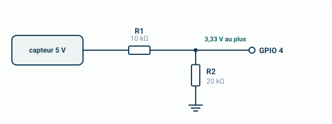
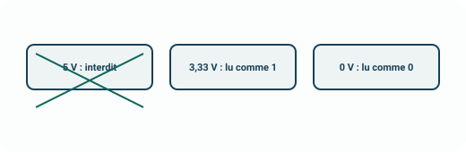

Beaucoup de capteurs et de modules sortent un signal logique en **5 V** : détecteur de présence, capteur à effet Hall, sortie d'une autre carte. Rappel de la règle 1 du module M1 : **5 V détruit une broche de l'ESP32**.

## Le pont diviseur sur une entrée

Deux résistances ramènent le niveau haut de 5 V à une tension acceptable.

Vs = Ve × R2 / (R1 + R2) = 5 V × 20 kΩ / 30 kΩ ≈ 3,33 V.

[[calc:divider]]

- Niveau haut du capteur, 5 V : l'entrée reçoit 3,33 V, bien au-dessus du seuil de 2,5 V : elle lit `HIGH`.
- Niveau bas du capteur, 0 V : l'entrée reçoit 0 V, elle lit `LOW`.

## Choisir les résistances

- Le **rapport** R2 / (R1 + R2) fixe la tension : 2 / 3 convient pour 5 V. Le module M1 utilisait 1 kΩ et 2 kΩ, même rapport.
- La **valeur** fixe le courant consommé : 5 V / 30 kΩ ≈ 0,17 mA. Des résistances de plusieurs dizaines de kilohms économisent le capteur ; au-delà de 100 kΩ, le signal devient sensible aux parasites.
- Avec un pont, on ne met **pas** de tirage interne sur l'entrée : `pinMode(SENSOR_PIN, INPUT)`. Le pont fixe déjà le niveau.

## À retenir

- Un signal de 5 V passe par un pont diviseur avant toute entrée.
- 10 kΩ et 20 kΩ donnent 3,33 V : l'entrée lit `HIGH`.
- Entrée en `INPUT`, sans tirage interne, derrière un pont.
