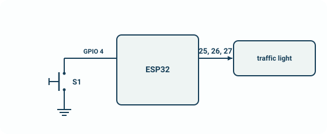

This mini-project brings outputs and inputs together: a traffic light that runs on its own, and a button that puts it into standby, flashing amber.

## Goal

Program a two-mode machine (cycle and standby) that reads the button at any time, even during green or red.

## Safety

- The whole circuit is powered by the computer's USB; no circuit in the course goes above **12 V** DC.
- Never 5 V on a pin: the button is wired between GPIO 4 and GND, with the internal pull-up.
- Wire with the USB cable unplugged.



## Equipment

| Quantity | Item |
|---|---|
| 1 | ESP32 DevKit board, breadboard and wires |
| 3 | green, amber (or yellow) and red LEDs, with three 330 Ω resistors |
| 1 | push button |
| 1 | multimeter |

## Program

A 5 s `delay` would make the button deaf during the whole green. So the program runs `loop()` every 20 ms and **counts the passes**: 250 passes of 20 ms make 5 s. At each pass, it reads the button.

```cpp
#include <Arduino.h>

const uint8_t BUTTON_PIN = 4;
const uint8_t GREEN_PIN = 25;
const uint8_t AMBER_PIN = 26;
const uint8_t RED_PIN = 27;
// One pass through loop() lasts 20 ms; durations are counted in passes
const uint32_t TICK_MS = 20;
const uint32_t GREEN_TICKS = 250;  // 5 s
const uint32_t AMBER_TICKS = 100;  // 2 s
const uint32_t RED_TICKS = 250;    // 5 s
const uint32_t BLINK_TICKS = 25;   // 0.5 s in standby

enum Mode { MODE_CYCLE, MODE_STANDBY };
enum Light { LIGHT_GREEN, LIGHT_AMBER, LIGHT_RED };

Mode mode = MODE_CYCLE;
Light light = LIGHT_GREEN;
uint32_t ticks = 0;  // passes elapsed in the current state
int previousLevel = HIGH;
bool amberOn = false;

void setup() {
  Serial.begin(115200);
  pinMode(BUTTON_PIN, INPUT_PULLUP);
  pinMode(GREEN_PIN, OUTPUT);
  pinMode(AMBER_PIN, OUTPUT);
  pinMode(RED_PIN, OUTPUT);
}

void loop() {
  // 1. Read the input: a press changes the mode
  int level = digitalRead(BUTTON_PIN);
  if (previousLevel == HIGH && level == LOW) {
    mode = (mode == MODE_CYCLE) ? MODE_STANDBY : MODE_CYCLE;
    light = LIGHT_GREEN;
    ticks = 0;
    Serial.println(mode == MODE_CYCLE ? "cycle" : "standby");
  }
  previousLevel = level;

  // 2. Compute: count the passes and change state at the right time
  ticks++;
  if (mode == MODE_CYCLE) {
    if (light == LIGHT_GREEN && ticks >= GREEN_TICKS) {
      light = LIGHT_AMBER;
      ticks = 0;
    } else if (light == LIGHT_AMBER && ticks >= AMBER_TICKS) {
      light = LIGHT_RED;
      ticks = 0;
    } else if (light == LIGHT_RED && ticks >= RED_TICKS) {
      light = LIGHT_GREEN;
      ticks = 0;
    }
  } else if (ticks >= BLINK_TICKS) {
    amberOn = !amberOn;
    ticks = 0;
  }

  // 3. Write the outputs
  bool cycle = (mode == MODE_CYCLE);
  digitalWrite(GREEN_PIN, cycle && light == LIGHT_GREEN ? HIGH : LOW);
  digitalWrite(AMBER_PIN, (cycle && light == LIGHT_AMBER) || (!cycle && amberOn) ? HIGH : LOW);
  digitalWrite(RED_PIN, cycle && light == LIGHT_RED ? HIGH : LOW);

  // The 20 ms pause paces the loop and lets the bounces pass
  delay(TICK_MS);
}
```

## Full kit variant

1. Wire, upload, open the serial monitor: each press shows "cycle" or "standby".
2. Press during green: the light goes into standby without waiting for green to end.
3. On the oscilloscope, channel 1 on GPIO 4: watch the bounces when pressing (time base of 1 ms per division). Channel 2 on GPIO 26 in standby: measure the flashing period.

## Multimeter-only variant

1. Same circuit and same program.
2. Measure the voltage of GPIO 4 with the button released, then pressed.
3. Time ten flashes in standby and deduce the period.

| Measurement | Expected | Measured |
|---|---|---|
| GPIO 4, button released | 3.3 V | |
| GPIO 4, button pressed | 0 V | |
| flashing period in standby | 1 s | |
| green duration | 5 s | |

## To conclude

Explain why this program reacts to the button during green, whereas the traffic light of module M2, written with `delay(GREEN_MS)`, could not.
