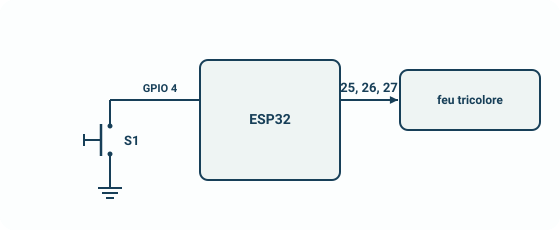

Ce mini-projet réunit les sorties et les entrées : un feu tricolore qui tourne seul, et un bouton qui le fait passer en veille, orange clignotant.

## Objectif

Programmer une machine à deux modes (cycle et veille) qui lit le bouton à tout moment, même pendant le vert ou le rouge.

## Sécurité

- Tout le montage est alimenté par l'USB de l'ordinateur ; aucun montage de la formation ne dépasse **12 V** en continu.
- Jamais 5 V sur une broche : le bouton se branche entre GPIO 4 et GND, avec le tirage interne.
- Câblez câble USB débranché.



## Matériel

| Quantité | Élément |
|---|---|
| 1 | carte DevKit ESP32, plaque d'essai et fils |
| 3 | LED verte, orange (ou jaune) et rouge, avec trois résistances de 330 Ω |
| 1 | bouton-poussoir |
| 1 | multimètre |

## Programme

Un `delay` de 5 s rendrait le bouton sourd pendant tout le vert. Le programme fait donc tourner `loop()` toutes les 20 ms et **compte les tours** : 250 tours de 20 ms font 5 s. À chaque tour, il lit le bouton.

```cpp
#include <Arduino.h>

const uint8_t BUTTON_PIN = 4;
const uint8_t GREEN_PIN = 25;
const uint8_t AMBER_PIN = 26;
const uint8_t RED_PIN = 27;
// Un tour de loop() dure 20 ms ; les durées se comptent en tours
const uint32_t TICK_MS = 20;
const uint32_t GREEN_TICKS = 250;  // 5 s
const uint32_t AMBER_TICKS = 100;  // 2 s
const uint32_t RED_TICKS = 250;    // 5 s
const uint32_t BLINK_TICKS = 25;   // 0,5 s en veille

enum Mode { MODE_CYCLE, MODE_STANDBY };
enum Light { LIGHT_GREEN, LIGHT_AMBER, LIGHT_RED };

Mode mode = MODE_CYCLE;
Light light = LIGHT_GREEN;
uint32_t ticks = 0;  // tours écoulés dans l'état courant
int previousLevel = HIGH;
bool amberOn = false;

void setup() {
  Serial.begin(115200);
  pinMode(BUTTON_PIN, INPUT_PULLUP);
  pinMode(GREEN_PIN, OUTPUT);
  pinMode(AMBER_PIN, OUTPUT);
  pinMode(RED_PIN, OUTPUT);
}

void loop() {
  // 1. Lire l'entrée : un appui change de mode
  int level = digitalRead(BUTTON_PIN);
  if (previousLevel == HIGH && level == LOW) {
    mode = (mode == MODE_CYCLE) ? MODE_STANDBY : MODE_CYCLE;
    light = LIGHT_GREEN;
    ticks = 0;
    Serial.println(mode == MODE_CYCLE ? "cycle" : "veille");
  }
  previousLevel = level;

  // 2. Calculer : compter les tours et changer d'état au bon moment
  ticks++;
  if (mode == MODE_CYCLE) {
    if (light == LIGHT_GREEN && ticks >= GREEN_TICKS) {
      light = LIGHT_AMBER;
      ticks = 0;
    } else if (light == LIGHT_AMBER && ticks >= AMBER_TICKS) {
      light = LIGHT_RED;
      ticks = 0;
    } else if (light == LIGHT_RED && ticks >= RED_TICKS) {
      light = LIGHT_GREEN;
      ticks = 0;
    }
  } else if (ticks >= BLINK_TICKS) {
    amberOn = !amberOn;
    ticks = 0;
  }

  // 3. Écrire les sorties
  bool cycle = (mode == MODE_CYCLE);
  digitalWrite(GREEN_PIN, cycle && light == LIGHT_GREEN ? HIGH : LOW);
  digitalWrite(AMBER_PIN, (cycle && light == LIGHT_AMBER) || (!cycle && amberOn) ? HIGH : LOW);
  digitalWrite(RED_PIN, cycle && light == LIGHT_RED ? HIGH : LOW);

  // La pause de 20 ms rythme la boucle et laisse passer les rebonds
  delay(TICK_MS);
}
```

## Variante kit complet

1. Câblez, téléversez, ouvrez le moniteur série : chaque appui affiche « cycle » ou « veille ».
2. Appuyez pendant le vert : le feu passe en veille sans attendre la fin du vert.
3. À l'oscilloscope, voie 1 sur GPIO 4 : observez les rebonds à l'appui (base de temps de 1 ms par division). Voie 2 sur GPIO 26 en veille : mesurez la période du clignotement.

## Variante multimètre seul

1. Même montage et même programme.
2. Mesurez la tension de GPIO 4 bouton relâché, puis bouton appuyé.
3. Chronométrez dix clignotements en veille et déduisez la période.

| Mesure | Attendue | Relevée |
|---|---|---|
| GPIO 4, bouton relâché | 3,3 V | |
| GPIO 4, bouton appuyé | 0 V | |
| période du clignotement en veille | 1 s | |
| durée du vert | 5 s | |

## Pour conclure

Expliquez pourquoi ce programme réagit au bouton pendant le vert, alors que le feu du module M2, écrit avec `delay(GREEN_MS)`, ne le pourrait pas.
