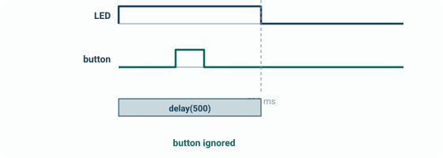

Since module M2, our programs wait with `delay(ms)`. It is simple, but during the wait the processor does **nothing else**: `delay` is said to be **blocking**.

## The problem

The following program blinks an LED and copies the state of a button to a second LED. Try it: the button LED reacts late, sometimes not at all.

```cpp
void loop() {
  // The button is read only once a second
  digitalWrite(BUTTON_LED_PIN, digitalRead(BUTTON_PIN) == LOW ? HIGH : LOW);
  digitalWrite(LED_PIN, HIGH);
  delay(HALF_PERIOD_MS);  // meanwhile, nothing else happens
  digitalWrite(LED_PIN, LOW);
  delay(HALF_PERIOD_MS);
}
```


One pass through `loop()` lasts one second, almost all of it waiting. The button is read only **once a second**: a short press that falls during a `delay` is never seen.



## When delay is fine

`delay` remains perfect when the program has **only one thing to do**: a start-up sequence, a pause before reading a sensor again, the short debouncing of module M3. As soon as an input must be watched **while** waiting, another method is needed: `millis()` (next section).

## Key points

- `delay` blocks the program: no input is read during the wait.
- A pass through `loop()` containing `delay`s lasts at least the sum of those `delay`s.
- To do several things "at the same time", drop `delay`.
