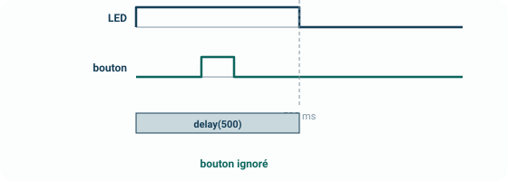

Depuis le module M2, nos programmes attendent avec `delay(ms)`. C'est simple, mais pendant l'attente le processeur ne fait **rien d'autre** : on dit que `delay` est **bloquant**.

## Le problème

Le programme suivant fait clignoter une LED et recopie l'état d'un bouton sur une seconde LED. Essayez-le : la LED du bouton réagit avec retard, parfois pas du tout.

```cpp
void loop() {
  // Le bouton n'est lu qu'une fois par seconde
  digitalWrite(BUTTON_LED_PIN, digitalRead(BUTTON_PIN) == LOW ? HIGH : LOW);
  digitalWrite(LED_PIN, HIGH);
  delay(HALF_PERIOD_MS);  // pendant ce temps, rien d'autre ne se passe
  digitalWrite(LED_PIN, LOW);
  delay(HALF_PERIOD_MS);
}
```


Le tour de `loop()` dure une seconde, dont presque tout en attente. Le bouton n'est lu qu'**une fois par seconde** : un appui bref, tombé pendant un `delay`, n'est jamais vu.



## Quand delay convient

`delay` reste parfait quand le programme n'a **qu'une chose à faire** : une séquence de démarrage, une pause avant de relire un capteur, l'anti-rebond court du module M3. Dès qu'il faut surveiller une entrée **pendant** qu'on attend, il faut une autre méthode : `millis()` (section suivante).

## À retenir

- `delay` bloque le programme : aucune entrée n'est lue pendant l'attente.
- Un tour de `loop()` qui contient des `delay` dure au moins la somme de ces `delay`.
- Pour faire plusieurs choses « en même temps », on abandonne `delay`.
