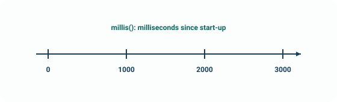
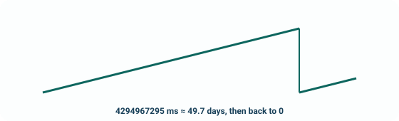

The `millis()` function returns the number of **milliseconds elapsed since the board started**. It blocks nothing: you check it the way you look at a clock.

## Measuring a duration

To know how much time has passed since an event, store the time of the event, then **subtract**:

duration = millis() − time of the event

Example: an event recorded at 1200 ms, a reading of `millis()` giving 1950 ms: 750 ms have elapsed.

## The right type: uint32_t

On the ESP32, `millis()` returns a 32-bit unsigned integer. So times are stored in `uint32_t` variables. An `int` or a `uint16_t` would overflow much earlier (a `uint16_t` counts only up to 65535 ms, barely a minute).

## The overflow at 49.7 days

A 32-bit counter goes up to 4294967295, then back to 0. In milliseconds, that is 4294967295 / 1000 / 3600 / 24 ≈ **49.7 days**.

A board running for months therefore sees `millis()` start again from zero. Good news: the subtraction of two `uint32_t` values **stays correct** across this wrap-around, because it is also computed modulo 2³². Simply always write the comparison as:

`millis() - lastMs >= periodMs`

and never `millis() >= lastMs + periodMs`, which goes wrong at the moment of the overflow.

## Key points

- `millis()`: milliseconds since start-up, without blocking.
- Times in `uint32_t` variables; duration = difference of two times.
- Back to 0 after 49.7 days: the form `now - last >= period` stays correct.
