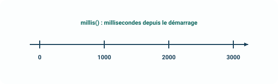
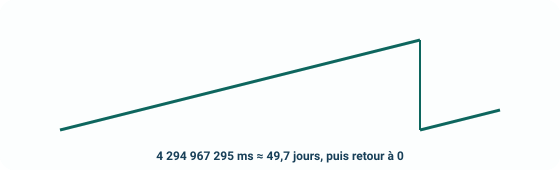

La fonction `millis()` renvoie le nombre de **millisecondes écoulées depuis le démarrage** de la carte. Elle ne bloque rien : on la consulte comme on regarde une horloge.

## Mesurer une durée

Pour savoir combien de temps s'est écoulé depuis un événement, on mémorise l'instant de l'événement, puis on fait une **soustraction** :

durée = millis() − instant de l'événement

Exemple : un événement noté à 1 200 ms, une lecture de `millis()` qui donne 1 950 ms : 750 ms se sont écoulées.

## Le bon type : uint32_t

Sur l'ESP32, `millis()` renvoie un entier sans signe de 32 bits. On range donc les instants dans des variables `uint32_t`. Un `int` ou un `uint16_t` déborderait beaucoup plus tôt (un `uint16_t` ne compte que jusqu'à 65 535 ms, à peine une minute).

## Le débordement à 49,7 jours

Un compteur de 32 bits va jusqu'à 4 294 967 295, puis revient à 0. En millisecondes, cela fait 4 294 967 295 / 1 000 / 3 600 / 24 ≈ **49,7 jours**.

Une carte qui tourne des mois voit donc `millis()` repartir de zéro. Bonne nouvelle : la soustraction de deux `uint32_t` **reste juste** à travers ce retour à zéro, car elle se calcule elle aussi modulo 2³². Il suffit d'écrire toujours la comparaison sous la forme :

`millis() - lastMs >= periodMs`

et jamais `millis() >= lastMs + periodMs`, qui se trompe au moment du débordement.

## À retenir

- `millis()` : millisecondes depuis le démarrage, sans bloquer.
- Instants dans des `uint32_t` ; durée = différence de deux instants.
- Retour à 0 après 49,7 jours : la forme `maintenant - dernier >= période` reste juste.
