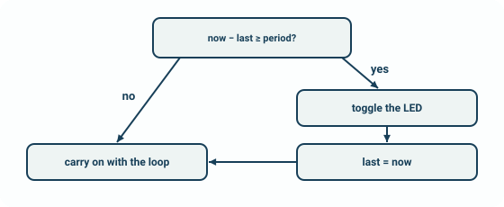
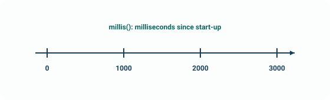

Here is the blinker of section 1 again, without `delay`. Instead of waiting, `loop()` runs non-stop and checks at each pass whether the half-period has elapsed.



```cpp
#include <Arduino.h>

const uint8_t BUTTON_PIN = 4;
const uint8_t LED_PIN = 25;
const uint8_t BUTTON_LED_PIN = 26;
const uint32_t HALF_PERIOD_MS = 500;

// Time of the last LED change, in milliseconds
uint32_t lastToggleMs = 0;
uint8_t ledState = 0;

void setup() {
  pinMode(BUTTON_PIN, INPUT_PULLUP);
  pinMode(LED_PIN, OUTPUT);
  pinMode(BUTTON_LED_PIN, OUTPUT);
}

void loop() {
  uint32_t now = millis();
  // The button is read at every pass, thousands of times a second
  digitalWrite(BUTTON_LED_PIN, digitalRead(BUTTON_PIN) == LOW ? HIGH : LOW);
  // The LED changes state when the half-period has elapsed
  if (now - lastToggleMs >= HALF_PERIOD_MS) {
    lastToggleMs = now;
    ledState ^= 1;
    digitalWrite(LED_PIN, ledState);
  }
}
```

## How it works

- `lastToggleMs` stores the time of the last change.
- At each pass, `now - lastToggleMs` gives the time elapsed since that change.
- When it reaches `HALF_PERIOD_MS`, the LED is inverted with `^= 1` (module M3) and the new time is recorded.
- The rest of the time, **nothing** is done and `loop()` starts again at once: the button is read thousands of times a second.



## Why `lastToggleMs = now`

The time is recorded **when the action happens**. If a pass through `loop()` was a little late, the blinking takes the same delay, but never runs wild. For a rhythm without drift over hours, write `lastToggleMs += HALF_PERIOD_MS` instead.

## Key points

- A non-blocking program never stops: it **checks** whether it is time to act.
- Recipe: `if (now - last >= period) { last = now; act(); }`.
- The button is now read all the time.
