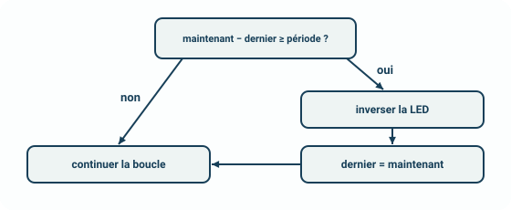
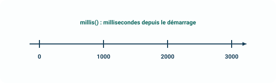

On reprend le clignotant de la section 1, sans `delay`. Au lieu d'attendre, `loop()` tourne sans cesse et regarde à chaque tour si la demi-période est écoulée.



```cpp
#include <Arduino.h>

const uint8_t BUTTON_PIN = 4;
const uint8_t LED_PIN = 25;
const uint8_t BUTTON_LED_PIN = 26;
const uint32_t HALF_PERIOD_MS = 500;

// Instant du dernier changement de la LED, en millisecondes
uint32_t lastToggleMs = 0;
uint8_t ledState = 0;

void setup() {
  pinMode(BUTTON_PIN, INPUT_PULLUP);
  pinMode(LED_PIN, OUTPUT);
  pinMode(BUTTON_LED_PIN, OUTPUT);
}

void loop() {
  uint32_t now = millis();
  // Le bouton est lu à chaque tour, des milliers de fois par seconde
  digitalWrite(BUTTON_LED_PIN, digitalRead(BUTTON_PIN) == LOW ? HIGH : LOW);
  // La LED change d'état quand la demi-période est écoulée
  if (now - lastToggleMs >= HALF_PERIOD_MS) {
    lastToggleMs = now;
    ledState ^= 1;
    digitalWrite(LED_PIN, ledState);
  }
}
```

## Comment ça marche

- `lastToggleMs` mémorise l'instant du dernier changement.
- À chaque tour, `now - lastToggleMs` donne le temps écoulé depuis ce changement.
- Quand il atteint `HALF_PERIOD_MS`, on inverse la LED avec `^= 1` (module M3) et on note le nouvel instant.
- Le reste du temps, on ne fait **rien** et `loop()` recommence aussitôt : le bouton est lu des milliers de fois par seconde.



## Pourquoi `lastToggleMs = now`

On note l'instant **au moment où l'on agit**. Si un tour de `loop()` a pris un peu de retard, le clignotement prend le même retard, mais ne s'emballe jamais. Pour un rythme sans dérive sur des heures, on écrit plutôt `lastToggleMs += HALF_PERIOD_MS`.

## À retenir

- Un programme non bloquant ne s'arrête jamais : il **teste** si c'est le moment d'agir.
- Recette : `if (now - last >= période) { last = now; agir(); }`.
- Le bouton est désormais lu en permanence.
