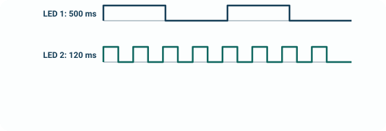
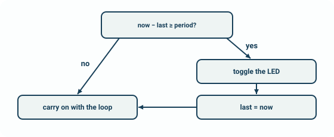

The recipe of the previous section is repeated for each task. Each task has **its own period** and **its own time of last pass**; they share the same loop without getting in each other's way.



```cpp
void loop() {
  uint32_t now = millis();
  // Each LED has its own period and time of last change
  if (now - led1LastMs >= LED1_HALF_MS) {
    led1LastMs = now;
    led1State ^= 1;
    digitalWrite(LED1_PIN, led1State);
  }
  if (now - led2LastMs >= LED2_HALF_MS) {
    led2LastMs = now;
    led2State ^= 1;
    digitalWrite(LED2_PIN, led2State);
  }
}
```

LED 1 changes every 500 ms (1 s period), LED 2 every 120 ms (240 ms period). Adding a third task, for example reading a sensor every 2 s, takes three more lines, without touching the first two.

## A single clock reading per pass

`now` is read once, at the start of `loop()`, then used by every task. This is the rule of module M3 applied to time: take a snapshot of the inputs (here the clock) before deciding.



## The limit of the method

A task that takes long (a forgotten `delay`, a heavy calculation) delays all the others. So each task must do **little at each pass** and hand back control quickly. To react to an event within microseconds, use interrupts (next section).

## Key points

- One task = one period + one time of last pass.
- All tasks share the same loop and read the same `now`.
- Each pass must be short.
