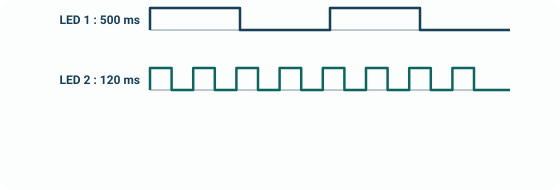
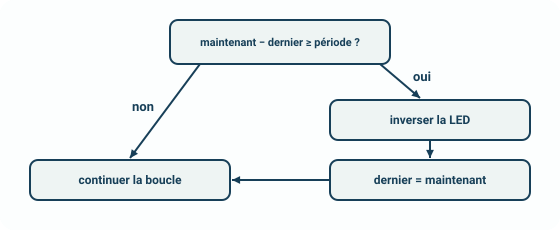

La recette de la section précédente se répète autant de fois qu'il y a de tâches. Chaque tâche a **sa période** et **son instant de dernier passage** ; elles se partagent la même boucle sans se gêner.



```cpp
void loop() {
  uint32_t now = millis();
  // Chaque LED a sa période et son instant de dernier changement
  if (now - led1LastMs >= LED1_HALF_MS) {
    led1LastMs = now;
    led1State ^= 1;
    digitalWrite(LED1_PIN, led1State);
  }
  if (now - led2LastMs >= LED2_HALF_MS) {
    led2LastMs = now;
    led2State ^= 1;
    digitalWrite(LED2_PIN, led2State);
  }
}
```

La LED 1 change toutes les 500 ms (période 1 s), la LED 2 toutes les 120 ms (période 240 ms). Ajouter une troisième tâche, par exemple lire un capteur toutes les 2 s, demande trois lignes de plus, sans toucher aux deux premières.

## Une seule lecture de l'horloge par tour

`now` est lu une fois, en tête de `loop()`, puis sert à toutes les tâches. C'est la règle du module M3 appliquée au temps : on photographie les entrées (ici l'horloge) avant de décider.



## La limite de la méthode

Une tâche qui dure longtemps (un `delay` oublié, un calcul lourd) retarde toutes les autres. Chaque tâche doit donc faire **peu de choses à chaque passage** et rendre vite la main. Pour réagir à un événement à la microseconde près, on passe aux interruptions (section suivante).

## À retenir

- Une tâche = une période + un instant de dernier passage.
- Toutes les tâches se partagent la même boucle et lisent le même `now`.
- Chaque passage doit être court.
