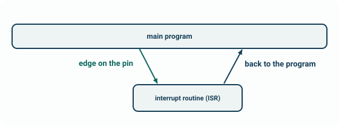
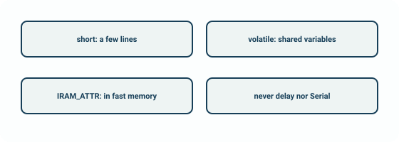

With `millis()`, the program regularly goes to **look** whether something has happened. An **interrupt** does the opposite: the event **alerts** the processor. As soon as an edge reaches the pin, the processor suspends `loop()`, runs a short function, the **interrupt service routine** (ISR), then resumes where it was.



## Counting presses

```cpp
#include <Arduino.h>

const uint8_t BUTTON_PIN = 4;
const uint32_t DEBOUNCE_MS = 50;

// Shared with the interrupt routine: volatile
volatile uint32_t pressCount = 0;
volatile uint32_t lastPressMs = 0;

// Interrupt routine: short, in fast memory
void IRAM_ATTR onPress() {
  uint32_t now = millis();
  if (now - lastPressMs >= DEBOUNCE_MS) {
    lastPressMs = now;
    pressCount++;
  }
}

void setup() {
  Serial.begin(115200);
  pinMode(BUTTON_PIN, INPUT_PULLUP);
  attachInterrupt(digitalPinToInterrupt(BUTTON_PIN), onPress, FALLING);
}

void loop() {
  static uint32_t shownCount = 0;
  if (pressCount != shownCount) {
    shownCount = pressCount;
    Serial.printf("Presses: %lu\n", (unsigned long)shownCount);
  }
}
```

`attachInterrupt(pin, routine, mode)` connects the routine to the pin. The mode chooses the event: `FALLING` (falling edge, the press with `INPUT_PULLUP`), `RISING` (rising edge) or `CHANGE` (both).

## The rules of an interrupt routine



- **Short**: a few lines. While it runs, everything else waits.
- **`volatile`** for every variable shared with `loop()`: the compiler reads it again from memory at each use instead of keeping a stale copy.
- **`IRAM_ATTR`**: on the ESP32, the routine is placed in fast memory, always available.
- **Never** `delay` nor `Serial.print` in the routine: it records the event, and `loop()` does the rest (here, the display).

Debouncing is done by time: a second edge less than 50 ms after the first is ignored.

## Key points

- An interrupt reacts at once to an edge, even when `loop()` is busy.
- `attachInterrupt(digitalPinToInterrupt(pin), routine, FALLING)`.
- Short routine, `IRAM_ATTR`, shared variables `volatile`, no `delay` nor `Serial`.
