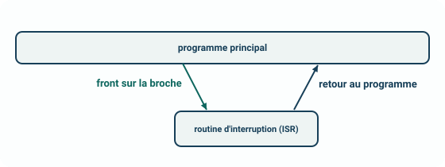
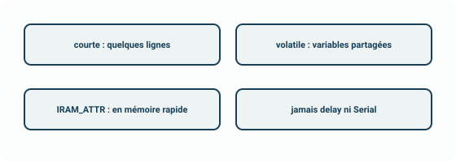

Avec `millis()`, le programme va **regarder** régulièrement si quelque chose s'est passé. Une **interruption** fait l'inverse : c'est l'événement qui **prévient** le processeur. Dès qu'un front arrive sur la broche, le processeur suspend `loop()`, exécute une courte fonction, la **routine d'interruption** (ISR), puis reprend là où il en était.



## Compter des appuis

```cpp
#include <Arduino.h>

const uint8_t BUTTON_PIN = 4;
const uint32_t DEBOUNCE_MS = 50;

// Partagées avec la routine d'interruption : volatile
volatile uint32_t pressCount = 0;
volatile uint32_t lastPressMs = 0;

// Routine d'interruption : courte, en mémoire rapide
void IRAM_ATTR onPress() {
  uint32_t now = millis();
  if (now - lastPressMs >= DEBOUNCE_MS) {
    lastPressMs = now;
    pressCount++;
  }
}

void setup() {
  Serial.begin(115200);
  pinMode(BUTTON_PIN, INPUT_PULLUP);
  attachInterrupt(digitalPinToInterrupt(BUTTON_PIN), onPress, FALLING);
}

void loop() {
  static uint32_t shownCount = 0;
  if (pressCount != shownCount) {
    shownCount = pressCount;
    Serial.printf("Appuis : %lu\n", (unsigned long)shownCount);
  }
}
```

`attachInterrupt(broche, routine, mode)` relie la routine à la broche. Le mode choisit l'événement : `FALLING` (front descendant, l'appui avec `INPUT_PULLUP`), `RISING` (front montant) ou `CHANGE` (les deux).

## Les règles d'une routine d'interruption



- **Courte** : quelques lignes. Pendant qu'elle tourne, le reste attend.
- **`volatile`** pour toute variable partagée avec `loop()` : le compilateur la relit en mémoire à chaque usage au lieu de garder une copie périmée.
- **`IRAM_ATTR`** : sur l'ESP32, la routine est placée en mémoire rapide, toujours disponible.
- **Jamais** de `delay`, ni de `Serial.print` dans la routine : elle note l'événement, et `loop()` fait le reste (ici, l'affichage).

L'anti-rebond se fait par le temps : un second front moins de 50 ms après le premier est ignoré.

## À retenir

- Une interruption réagit tout de suite à un front, même si `loop()` est occupée.
- `attachInterrupt(digitalPinToInterrupt(broche), routine, FALLING)`.
- Routine courte, `IRAM_ATTR`, variables partagées `volatile`, pas de `delay` ni de `Serial`.
