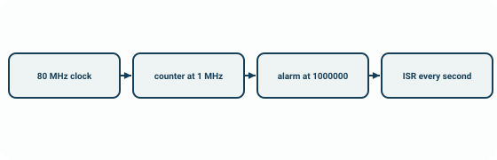
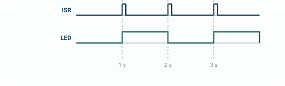

A **hardware timer** is a counter of the chip that moves forward on its own, driven by a clock, without the processor. When it reaches a chosen value, the **alarm**, it triggers an interrupt. This gives an action at a very regular interval, even when `loop()` is busy.



## The program (Arduino-ESP32 3.x core)

```cpp
#include <Arduino.h>

const uint8_t LED_PIN = 25;
// The timer counter moves one step per microsecond (1 MHz)
const uint32_t TIMER_FREQ_HZ = 1000000;
const uint64_t ALARM_TICKS = 1000000;  // 1000000 steps = 1 s

hw_timer_t *timer = nullptr;
volatile bool tick = false;

void IRAM_ATTR onTimer() {
  tick = true;
}

void setup() {
  pinMode(LED_PIN, OUTPUT);
  timer = timerBegin(TIMER_FREQ_HZ);
  timerAttachInterrupt(timer, onTimer);
  timerAlarm(timer, ALARM_TICKS, true, 0);  // alarm repeated forever
}

void loop() {
  if (tick) {
    tick = false;
    digitalWrite(LED_PIN, !digitalRead(LED_PIN));
  }
}
```

- `timerBegin(1000000)` sets the counter to 1 MHz: one step per microsecond.
- `timerAttachInterrupt` connects the routine to the timer.
- `timerAlarm(timer, 1000000, true, 0)` triggers the alarm at 1000000 steps, that is 1 s, and repeats it (`true`) without limit (`0`).



The routine only raises a flag, `tick`; `loop()` acts. Time between two alarms: alarm steps / counter frequency. With 250000 steps at 1 MHz: 0.25 s.

> Many older examples use `timerBegin(0, 80, true)`: this is the 2.x core API, which no longer builds with the 3.x core used in the course.

## millis, interrupt or timer?

| Need | Tool |
|---|---|
| several rhythms of a millisecond or more | `millis()` |
| react at once to an edge on a pin | pin interrupt |
| a very regular rhythm, independent of `loop()` | hardware timer |

## Key points

- A timer counts on its own; its alarm triggers an interrupt.
- 3.x: `timerBegin(frequency)`, `timerAttachInterrupt`, `timerAlarm(timer, steps, repeat, count)`.
- Interval = alarm steps / counter frequency.
