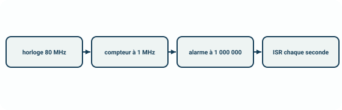
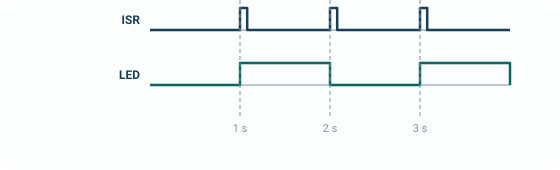

Un **timer matériel** est un compteur de la puce qui avance tout seul, au rythme d'une horloge, sans le processeur. Quand il atteint une valeur choisie, l'**alarme**, il déclenche une interruption. On obtient ainsi une action à intervalle très régulier, même si `loop()` est occupée.



## Le programme (cœur Arduino-ESP32 3.x)

```cpp
#include <Arduino.h>

const uint8_t LED_PIN = 25;
// Le compteur du timer avance d'un pas par microseconde (1 MHz)
const uint32_t TIMER_FREQ_HZ = 1000000;
const uint64_t ALARM_TICKS = 1000000;  // 1 000 000 pas = 1 s

hw_timer_t *timer = nullptr;
volatile bool tick = false;

void IRAM_ATTR onTimer() {
  tick = true;
}

void setup() {
  pinMode(LED_PIN, OUTPUT);
  timer = timerBegin(TIMER_FREQ_HZ);
  timerAttachInterrupt(timer, onTimer);
  timerAlarm(timer, ALARM_TICKS, true, 0);  // alarme répétée sans fin
}

void loop() {
  if (tick) {
    tick = false;
    digitalWrite(LED_PIN, !digitalRead(LED_PIN));
  }
}
```

- `timerBegin(1000000)` règle le compteur à 1 MHz : un pas par microseconde.
- `timerAttachInterrupt` relie la routine au timer.
- `timerAlarm(timer, 1000000, true, 0)` déclenche l'alarme à 1 000 000 pas, soit 1 s, et la répète (`true`) sans limite (`0`).



La routine se contente de lever un drapeau, `tick` ; `loop()` agit. Durée entre deux alarmes : pas d'alarme / fréquence du compteur. Avec 250 000 pas à 1 MHz : 0,25 s.

> Beaucoup d'exemples anciens utilisent `timerBegin(0, 80, true)` : c'est l'API du cœur 2.x, qui ne compile plus avec le cœur 3.x utilisé dans la formation.

## millis, interruption ou timer ?

| Besoin | Outil |
|---|---|
| plusieurs rythmes de l'ordre de la milliseconde ou plus | `millis()` |
| réagir tout de suite à un front sur une broche | interruption de broche |
| un rythme très régulier, indépendant de `loop()` | timer matériel |

## À retenir

- Un timer compte seul ; son alarme déclenche une interruption.
- 3.x : `timerBegin(fréquence)`, `timerAttachInterrupt`, `timerAlarm(timer, pas, répéter, nombre)`.
- Intervalle = pas d'alarme / fréquence du compteur.
