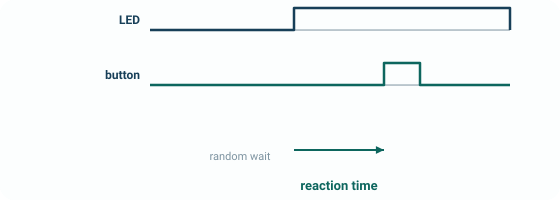

This mini-project measures your **reaction time**: after a random wait, the LED lights up; press as fast as you can. An interrupt records the exact time of the press, `millis()` measures the rest.

## Goal

Combine a state machine, non-blocking `millis()` and a pin interrupt to measure a duration to the millisecond.

## Safety

- Circuit powered by the computer's USB; no circuit in the course goes above **12 V** DC.
- Never 5 V on a pin: the button is wired between GPIO 4 and GND, with the internal pull-up.
- Wire with the USB cable unplugged.



## Equipment

| Quantity | Item |
|---|---|
| 1 | ESP32 DevKit board, breadboard and wires |
| 1 | LED and 330 Ω resistor on GPIO 25 |
| 1 | push button between GPIO 4 and GND |
| 1 | multimeter |

## Program

```cpp
#include <Arduino.h>

const uint8_t BUTTON_PIN = 4;
const uint8_t LED_PIN = 25;
const uint32_t MIN_WAIT_MS = 2000;
const uint32_t MAX_WAIT_MS = 5000;

enum Step { STEP_WAIT, STEP_LIT, STEP_DONE };

Step step = STEP_WAIT;
uint32_t stepStartMs = 0;
uint32_t waitMs = 0;
volatile uint32_t pressMs = 0;
volatile bool pressed = false;

void IRAM_ATTR onPress() {
  if (!pressed) {
    pressMs = millis();
    pressed = true;
  }
}

void startRound() {
  digitalWrite(LED_PIN, LOW);
  waitMs = random(MIN_WAIT_MS, MAX_WAIT_MS);
  stepStartMs = millis();
  pressed = false;
  step = STEP_WAIT;
  Serial.println("Wait for the LED to light up...");
}

void setup() {
  Serial.begin(115200);
  pinMode(BUTTON_PIN, INPUT_PULLUP);
  pinMode(LED_PIN, OUTPUT);
  randomSeed(esp_random());
  attachInterrupt(digitalPinToInterrupt(BUTTON_PIN), onPress, FALLING);
  startRound();
}

void loop() {
  uint32_t now = millis();
  if (step == STEP_WAIT) {
    if (pressed) {
      Serial.println("Too early! Starting again.");
      delay(1000);
      startRound();
    } else if (now - stepStartMs >= waitMs) {
      digitalWrite(LED_PIN, HIGH);
      stepStartMs = now;
      step = STEP_LIT;
    }
  } else if (step == STEP_LIT && pressed) {
    Serial.printf("Reaction time: %lu ms\n", (unsigned long)(pressMs - stepStartMs));
    step = STEP_DONE;
    stepStartMs = now;
  } else if (step == STEP_DONE && now - stepStartMs >= 3000) {
    startRound();
  }
}
```

## Full kit variant

1. Wire, upload, open the serial monitor and make ten attempts; write down the times.
2. On the oscilloscope, channel 1 on GPIO 25 (LED), channel 2 on GPIO 4 (button): measure the gap between the rising edge of the LED and the falling edge of the button, and compare it with the time shown.

## Multimeter-only variant

1. Same circuit and same program; make ten attempts and write down the times shown.
2. Measure the voltage of GPIO 25 during the wait, then with the LED on.
3. Work out the average of your ten times.

| Measurement | Expected | Measured |
|---|---|---|
| GPIO 25 during the wait | 0 V | |
| GPIO 25, LED on | 3.3 V | |
| average reaction time | about 200 to 400 ms | |
| wait before the LED | between 2 and 5 s | |

## To conclude

Explain why a press during the wait is detected at once, even though `loop()` never reads the button pin.
