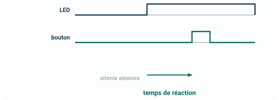

Ce mini-projet mesure votre **temps de réaction** : après une attente au hasard, la LED s'allume ; appuyez le plus vite possible. Une interruption note l'instant exact de l'appui, `millis()` mesure le reste.

## Objectif

Combiner une machine à états, `millis()` sans blocage et une interruption de broche pour mesurer une durée à la milliseconde.

## Sécurité

- Montage alimenté par l'USB de l'ordinateur ; aucun montage de la formation ne dépasse **12 V** en continu.
- Jamais 5 V sur une broche : le bouton se branche entre GPIO 4 et GND, avec le tirage interne.
- Câblez câble USB débranché.



## Matériel

| Quantité | Élément |
|---|---|
| 1 | carte DevKit ESP32, plaque d'essai et fils |
| 1 | LED et résistance de 330 Ω sur GPIO 25 |
| 1 | bouton-poussoir entre GPIO 4 et GND |
| 1 | multimètre |

## Programme

```cpp
#include <Arduino.h>

const uint8_t BUTTON_PIN = 4;
const uint8_t LED_PIN = 25;
const uint32_t MIN_WAIT_MS = 2000;
const uint32_t MAX_WAIT_MS = 5000;

enum Step { STEP_WAIT, STEP_LIT, STEP_DONE };

Step step = STEP_WAIT;
uint32_t stepStartMs = 0;
uint32_t waitMs = 0;
volatile uint32_t pressMs = 0;
volatile bool pressed = false;

void IRAM_ATTR onPress() {
  if (!pressed) {
    pressMs = millis();
    pressed = true;
  }
}

void startRound() {
  digitalWrite(LED_PIN, LOW);
  waitMs = random(MIN_WAIT_MS, MAX_WAIT_MS);
  stepStartMs = millis();
  pressed = false;
  step = STEP_WAIT;
  Serial.println("Attendez que la LED s'allume...");
}

void setup() {
  Serial.begin(115200);
  pinMode(BUTTON_PIN, INPUT_PULLUP);
  pinMode(LED_PIN, OUTPUT);
  randomSeed(esp_random());
  attachInterrupt(digitalPinToInterrupt(BUTTON_PIN), onPress, FALLING);
  startRound();
}

void loop() {
  uint32_t now = millis();
  if (step == STEP_WAIT) {
    if (pressed) {
      Serial.println("Trop tôt ! On recommence.");
      delay(1000);
      startRound();
    } else if (now - stepStartMs >= waitMs) {
      digitalWrite(LED_PIN, HIGH);
      stepStartMs = now;
      step = STEP_LIT;
    }
  } else if (step == STEP_LIT && pressed) {
    Serial.printf("Temps de réaction : %lu ms\n", (unsigned long)(pressMs - stepStartMs));
    step = STEP_DONE;
    stepStartMs = now;
  } else if (step == STEP_DONE && now - stepStartMs >= 3000) {
    startRound();
  }
}
```

## Variante kit complet

1. Câblez, téléversez, ouvrez le moniteur série et faites dix essais ; notez les temps.
2. À l'oscilloscope, voie 1 sur GPIO 25 (LED), voie 2 sur GPIO 4 (bouton) : mesurez l'écart entre le front montant de la LED et le front descendant du bouton, et comparez-le au temps affiché.

## Variante multimètre seul

1. Même montage et même programme ; faites dix essais et notez les temps affichés.
2. Mesurez la tension de GPIO 25 pendant l'attente, puis LED allumée.
3. Calculez la moyenne de vos dix temps.

| Mesure | Attendue | Relevée |
|---|---|---|
| GPIO 25 pendant l'attente | 0 V | |
| GPIO 25, LED allumée | 3,3 V | |
| temps de réaction moyen | 200 à 400 ms environ | |
| attente avant la LED | entre 2 et 5 s | |

## Pour conclure

Expliquez pourquoi un appui pendant l'attente est détecté tout de suite, alors que `loop()` ne lit jamais la broche du bouton.
