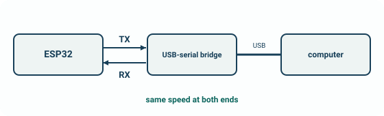
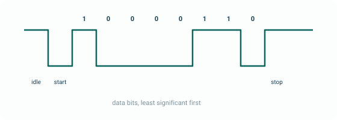

The **serial monitor** is the dialogue window between the ESP32 and the computer. It relies on a **UART** (universal asynchronous receiver-transmitter), a peripheral that sends bytes one bit after another on a single wire.

## The data path

UART 0 of the ESP32 transmits on **TX** (GPIO 1) and receives on **RX** (GPIO 3). On the DevKit board, these two pins go to the USB-serial bridge (module M1), which turns them into USB for the computer. It is the same path as uploading.

## The 8N1 frame

A serial link has no clock wire: both sides have agreed **in advance** on the speed. Each byte travels in a **frame**:

- at rest, the line is high;
- a **start bit** at 0 announces the byte;
- **8 data bits**, least significant first;
- **no parity bit**;
- a **stop bit** at 1.

Hence the name **8N1**: 8 bits, No parity, 1 stop bit. Each byte therefore takes **10 bits** on the line.

## The speed

The speed is counted in **bit/s** (also called baud). At 115200 bit/s, a bit lasts 1 / 115200 ≈ 8.7 µs, a 10-bit byte about 86.8 µs, and the line carries at most 11520 bytes per second.

[[calc:uart]]

## Key points

- UART 0: TX on GPIO 1, RX on GPIO 3, connected to the USB-serial bridge.
- 8N1: start, 8 data bits, stop; 10 bits per byte.
- Bytes per second = bit rate / 10.
