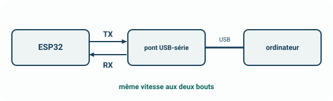
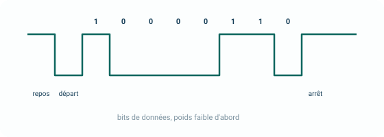

Le **moniteur série** est la fenêtre de dialogue entre l'ESP32 et l'ordinateur. Il repose sur une **UART** (émetteur-récepteur asynchrone universel), un périphérique qui envoie les octets un bit après l'autre sur un seul fil.

## Le chemin des données

L'UART 0 de l'ESP32 émet sur **TX** (GPIO 1) et reçoit sur **RX** (GPIO 3). Sur la carte DevKit, ces deux broches vont au pont USB-série (module M1), qui les transforme en USB pour l'ordinateur. C'est le même chemin que celui du téléversement.

## La trame 8N1

Une liaison série n'a pas de fil d'horloge : les deux côtés se sont mis d'accord **à l'avance** sur la vitesse. Chaque octet voyage dans une **trame** :

- au repos, la ligne est au niveau haut ;
- un **bit de départ** à 0 annonce l'octet ;
- **8 bits de données**, le poids faible en premier ;
- **pas de bit de parité** ;
- un **bit d'arrêt** à 1.

D'où le nom **8N1** : 8 bits, *No parity*, 1 bit d'arrêt. Chaque octet occupe donc **10 bits** sur la ligne.

## La vitesse

La vitesse se compte en **bit/s** (on dit aussi bauds). À 115 200 bit/s, un bit dure 1 / 115 200 ≈ 8,7 µs, un octet de 10 bits environ 86,8 µs, et la ligne transporte au plus 11 520 octets par seconde.

[[calc:uart]]

## À retenir

- UART 0 : TX sur GPIO 1, RX sur GPIO 3, reliés au pont USB-série.
- 8N1 : départ, 8 bits de données, arrêt ; 10 bits par octet.
- Octets par seconde = débit / 10.
