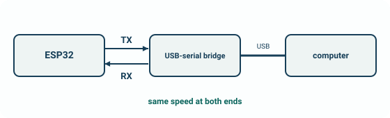

Before sending anything, the program opens the serial link in `setup()` and sets its speed:

```cpp
void setup() {
  // Same speed as monitor_speed in platformio.ini
  Serial.begin(SERIAL_BAUD);
  delay(1000);
  Serial.println("Start-up");
}
```

## The same speed at both ends

The PlatformIO serial monitor must listen **at the same speed**. This is the role of the `monitor_speed = 115200` line of the reference `platformio.ini` (module M1).


If the two speeds differ, the receiver slices the bits at the wrong rhythm: the monitor shows unreadable characters. This is the first thing to check when the text makes no sense: `Serial.begin` and `monitor_speed`.

At start-up, the chip itself sends a few log lines at 115200 bit/s: one more reason to choose this speed everywhere.

## The `delay(1000)` at the start

Just after an upload, the monitor takes a moment to open. A short wait in `setup()` avoids losing the first lines. This `delay` does no harm: it runs only once.



## Key points

- `Serial.begin(115200)` in `setup()`, `monitor_speed = 115200` in `platformio.ini`.
- Different speeds: unreadable characters.
- A named constant (`SERIAL_BAUD`) avoids typing mistakes.
