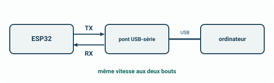

Avant d'envoyer quoi que ce soit, le programme ouvre la liaison série dans `setup()` et fixe sa vitesse :

```cpp
void setup() {
  // Même vitesse que monitor_speed dans platformio.ini
  Serial.begin(SERIAL_BAUD);
  delay(1000);
  Serial.println("Démarrage");
}
```

## La même vitesse aux deux bouts

Le moniteur série de PlatformIO doit écouter **à la même vitesse**. C'est le rôle de la ligne `monitor_speed = 115200` du `platformio.ini` de référence (module M1).


Si les deux vitesses diffèrent, le récepteur découpe les bits au mauvais rythme : le moniteur affiche des caractères illisibles. C'est le premier réflexe en cas de texte incompréhensible : vérifier `Serial.begin` et `monitor_speed`.

Au démarrage, la puce elle-même envoie quelques lignes de journal à 115 200 bit/s : c'est une raison de plus pour choisir cette vitesse partout.

## Le `delay(1000)` du début

Juste après un téléversement, le moniteur met un instant à s'ouvrir. Une courte attente dans `setup()` évite de perdre les premières lignes. Ce `delay` ne gêne pas : il n'est exécuté qu'une fois.



## À retenir

- `Serial.begin(115200)` dans `setup()`, `monitor_speed = 115200` dans `platformio.ini`.
- Vitesses différentes : caractères illisibles.
- Une constante nommée (`SERIAL_BAUD`) évite les fautes de frappe.
