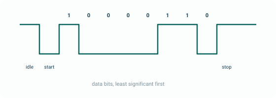

Three functions send text to the monitor:

| Function | What it does |
|---|---|
| `Serial.print(x)` | writes `x` (text or number), without a new line |
| `Serial.println(x)` | writes `x` then goes to a new line |
| `Serial.printf(format, ...)` | writes a text in which markers are replaced by values |


## A measuring program

```cpp
#include <Arduino.h>

const uint32_t SERIAL_BAUD = 115200;
const uint8_t SENSOR_PIN = 34;

void setup() {
  // Same speed as monitor_speed in platformio.ini
  Serial.begin(SERIAL_BAUD);
  delay(1000);
  Serial.println("Start-up");
}

void loop() {
  uint16_t raw = analogRead(SENSOR_PIN);
  float volts = raw * 3.3f / 4095.0f;
  Serial.print("Raw value: ");
  Serial.println(raw);
  Serial.printf("Voltage: %.2f V, time: %lu ms\n", volts, (unsigned long)millis());
  delay(1000);
}
```

## The printf markers

| Marker | Value | Example |
|---|---|---|
| `%d` | signed integer | `%d` with 12 gives `12` |
| `%u` | unsigned integer | `%u` with 4095 gives `4095` |
| `%lu` | unsigned long integer | for `millis()`, cast to `unsigned long` |
| `%.2f` | decimal number, 2 decimals | `%.2f` with 3.3 gives `3.30` |
| `%s` | text | `%s` with `"green"` gives `green` |
| `%c` | one character | `%c` with 97 gives `a` |
| `\n` | new line | essential at the end of a `printf` |

`println(3.3)` shows `3.30`: by default, a decimal number is written with two decimals, and always with a **point**.



## What a transmission costs

Each character sent takes about 87 µs at 115200 bit/s. A 40-character line therefore keeps the link busy for 3.5 ms. Sending at every pass through `loop()` floods the monitor and slows the program: send at a sensible rhythm, here once a second.

## Key points

- `print` without a new line, `println` with one, `printf` with markers.
- End a `printf` with `\n`.
- Do not send more often than needed.
