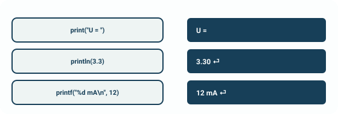
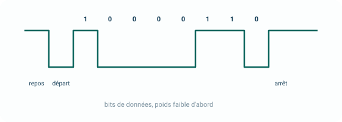

Trois fonctions envoient du texte vers le moniteur :

| Fonction | Ce qu'elle fait |
|---|---|
| `Serial.print(x)` | écrit `x` (texte ou nombre), sans aller à la ligne |
| `Serial.println(x)` | écrit `x` puis passe à la ligne |
| `Serial.printf(format, ...)` | écrit un texte où des marqueurs sont remplacés par des valeurs |



## Un programme de mesure

```cpp
#include <Arduino.h>

const uint32_t SERIAL_BAUD = 115200;
const uint8_t SENSOR_PIN = 34;

void setup() {
  // Même vitesse que monitor_speed dans platformio.ini
  Serial.begin(SERIAL_BAUD);
  delay(1000);
  Serial.println("Démarrage");
}

void loop() {
  uint16_t raw = analogRead(SENSOR_PIN);
  float volts = raw * 3.3f / 4095.0f;
  Serial.print("Valeur brute : ");
  Serial.println(raw);
  Serial.printf("Tension : %.2f V, temps : %lu ms\n", volts, (unsigned long)millis());
  delay(1000);
}
```

## Les marqueurs de printf

| Marqueur | Valeur | Exemple |
|---|---|---|
| `%d` | entier signé | `%d` avec 12 donne `12` |
| `%u` | entier sans signe | `%u` avec 4095 donne `4095` |
| `%lu` | entier long sans signe | pour `millis()`, converti en `unsigned long` |
| `%.2f` | nombre à virgule, 2 décimales | `%.2f` avec 3.3 donne `3.30` |
| `%s` | texte | `%s` avec `"vert"` donne `vert` |
| `%c` | un caractère | `%c` avec 97 donne `a` |
| `\n` | retour à la ligne | indispensable en fin de `printf` |

`println(3.3)` affiche `3.30` : par défaut, un nombre à virgule s'écrit avec deux décimales, et toujours avec un **point**, jamais une virgule.



## Ce que coûte un envoi

Chaque caractère envoyé prend environ 87 µs à 115 200 bit/s. Une ligne de 40 caractères occupe donc la liaison 3,5 ms. Envoyer à chaque tour de `loop()` noie le moniteur et ralentit le programme : on envoie à un rythme raisonnable, ici une fois par seconde.

## À retenir

- `print` sans retour à la ligne, `println` avec, `printf` avec des marqueurs.
- Terminez un `printf` par `\n`.
- N'envoyez pas plus souvent que nécessaire.
