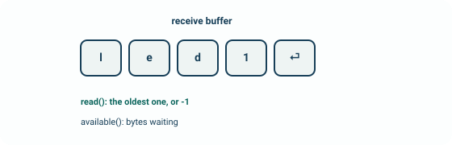
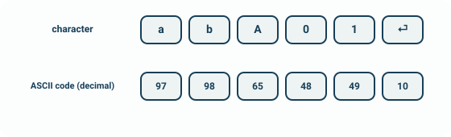

The serial monitor also works the other way: what you type goes to the ESP32. The bytes received wait in a **buffer** until the program reads them.



- `Serial.available()` returns the **number of bytes** waiting (0 if nothing has arrived);
- `Serial.read()` returns the **oldest** byte and removes it from the buffer, or **-1** if the buffer is empty.

## A character is a number

What is received is not a letter but its **ASCII code**: a number between 0 and 127.



The following program shows the code of each character typed:

```cpp
#include <Arduino.h>

void setup() {
  Serial.begin(115200);
  Serial.println("Type characters then Enter");
}

void loop() {
  // available(): number of received bytes waiting
  while (Serial.available() > 0) {
    int code = Serial.read();  // the oldest byte, or -1
    Serial.printf("character '%c': code %d\n", (char)code, code);
  }
}
```

Type `a` then Enter: the monitor shows `character 'a': code 97`, then the code 10 of the Enter key (line feed). Depending on the monitor setting, Enter also sends the code 13 (carriage return).

## The digit trap

Typing `5` does not send the number 5 but the character `'5'`, code 53. To get the value back, subtract the code of `'0'`: `'5' - '0'` is 53 − 48 = 5. For a number of several digits, read the whole line (next section).

## Key points

- `available()`: how many bytes are waiting; `read()`: the oldest, or -1.
- ASCII codes are received: `'a'` = 97, `'A'` = 65, `'0'` = 48, Enter = 10.
- Typed digit → value: `c - '0'`.
