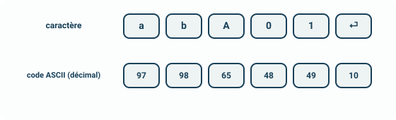

Le moniteur série fonctionne aussi dans l'autre sens : ce que vous tapez part vers l'ESP32. Les octets reçus attendent dans un **tampon** jusqu'à ce que le programme les lise.


- `Serial.available()` renvoie le **nombre d'octets** en attente (0 si rien n'est arrivé) ;
- `Serial.read()` renvoie le **plus ancien** octet et le retire du tampon, ou **-1** si le tampon est vide.

## Un caractère est un nombre

Ce que l'on reçoit n'est pas une lettre, mais son **code ASCII** : un nombre entre 0 et 127.



Le programme suivant affiche le code de chaque caractère tapé :

```cpp
#include <Arduino.h>

void setup() {
  Serial.begin(115200);
  Serial.println("Tapez des caractères puis Entrée");
}

void loop() {
  // available() : nombre d'octets reçus en attente
  while (Serial.available() > 0) {
    int code = Serial.read();  // le plus ancien octet, ou -1
    Serial.printf("caractère '%c' : code %d\n", (char)code, code);
  }
}
```

Tapez `a` puis Entrée : le moniteur affiche `caractère 'a' : code 97`, puis le code 10 de la touche Entrée (saut de ligne). Selon le réglage du moniteur, Entrée envoie aussi le code 13 (retour chariot).

## Le piège du chiffre

Taper `5` n'envoie pas le nombre 5 mais le caractère `'5'`, de code 53. Pour retrouver la valeur, on soustrait le code de `'0'` : `'5' - '0'` vaut 53 − 48 = 5. Pour un nombre de plusieurs chiffres, on lit toute la ligne (section suivante).

## À retenir

- `available()` : combien d'octets attendent ; `read()` : le plus ancien, ou -1.
- On reçoit des codes ASCII : `'a'` = 97, `'A'` = 65, `'0'` = 48, Entrée = 10.
- Chiffre tapé → valeur : `c - '0'`.
