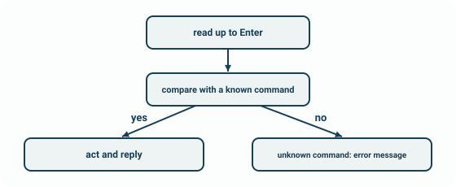

To control the board from the computer, read a whole **line**, ended by Enter, and compare it with a list of known commands.



```cpp
#include <Arduino.h>

const uint8_t LED_PIN = 25;

void setup() {
  Serial.begin(115200);
  pinMode(LED_PIN, OUTPUT);
  Serial.println("Commands: on, off, state");
}

void loop() {
  if (Serial.available() > 0) {
    // A whole line, up to Enter
    String line = Serial.readStringUntil('\n');
    line.trim();
    if (line == "on") {
      digitalWrite(LED_PIN, HIGH);
      Serial.println("LED on");
    } else if (line == "off") {
      digitalWrite(LED_PIN, LOW);
      Serial.println("LED off");
    } else if (line == "state") {
      Serial.println(digitalRead(LED_PIN) == HIGH ? "on" : "off");
    } else {
      Serial.printf("Unknown command: %s\n", line.c_str());
    }
  }
}
```

## The functions used

- `Serial.readStringUntil('\n')` reads the characters up to the line feed and returns them as text (`String`). If the line is slow to come, it waits one second at most.
- `line.trim()` removes spaces and the carriage return (code 13) at the start and end of the line: without it, `"on\r"` would not equal `"on"`.
- `line == "on"` compares two texts.
- An unknown command gets a **reply**: the user knows the board heard it, and sees the typing mistake.


## Reading a number

For a command with a value, `Serial.parseInt()` reads the digits and returns the integer; `line.toInt()` does the same on a line already read. Example: the line `delay 250` splits into a word and a number.

## Key points

- One command = one line, read with `readStringUntil('\n')` then `trim()`.
- Compare with the known commands; reply to unknown commands too.
- `parseInt()` or `toInt()` for numbers.
