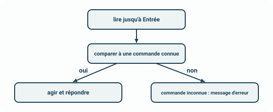

Pour commander la carte depuis l'ordinateur, on lit une **ligne** entière, terminée par Entrée, et on la compare à une liste de commandes connues.



```cpp
#include <Arduino.h>

const uint8_t LED_PIN = 25;

void setup() {
  Serial.begin(115200);
  pinMode(LED_PIN, OUTPUT);
  Serial.println("Commandes : on, off, etat");
}

void loop() {
  if (Serial.available() > 0) {
    // Une ligne entière, jusqu'à Entrée
    String line = Serial.readStringUntil('\n');
    line.trim();
    if (line == "on") {
      digitalWrite(LED_PIN, HIGH);
      Serial.println("LED allumée");
    } else if (line == "off") {
      digitalWrite(LED_PIN, LOW);
      Serial.println("LED éteinte");
    } else if (line == "etat") {
      Serial.println(digitalRead(LED_PIN) == HIGH ? "allumée" : "éteinte");
    } else {
      Serial.printf("Commande inconnue : %s\n", line.c_str());
    }
  }
}
```

## Les fonctions utilisées

- `Serial.readStringUntil('\n')` lit les caractères jusqu'au saut de ligne et les rend sous forme de texte (`String`). Si la ligne tarde, elle attend au plus une seconde.
- `line.trim()` enlève les espaces et le retour chariot (code 13) en début et fin de ligne : sans lui, `"on\r"` ne vaudrait pas `"on"`.
- `line == "on"` compare deux textes.
- Une commande inconnue reçoit une **réponse** : l'utilisateur sait que la carte l'a entendu, et voit sa faute de frappe.


## Lire un nombre

Pour une commande avec une valeur, `Serial.parseInt()` lit les chiffres et renvoie l'entier ; `line.toInt()` fait de même sur une ligne déjà lue. Exemple : la ligne `delai 250` se découpe en un mot et un nombre.

## À retenir

- Une commande = une ligne, lue avec `readStringUntil('\n')` puis `trim()`.
- Comparer aux commandes connues ; répondre aussi aux commandes inconnues.
- `parseInt()` ou `toInt()` pour les nombres.
