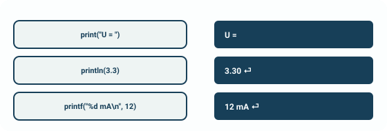

A microcontroller has no screen: when a program does not do what is expected, the serial monitor becomes the diagnostic instrument. It shows a **trace**: the important values, at each step.


Example: the toggle of module M3, with a trace at each change of the button.

```cpp
#include <Arduino.h>

const uint8_t BUTTON_PIN = 4;
const uint8_t LED_PIN = 25;
// Set to false to turn the trace off without touching the rest
const bool TRACE = true;

int previousLevel = HIGH;
uint8_t ledState = 0;

void setup() {
  Serial.begin(115200);
  pinMode(BUTTON_PIN, INPUT_PULLUP);
  pinMode(LED_PIN, OUTPUT);
}

void loop() {
  int level = digitalRead(BUTTON_PIN);
  if (previousLevel == HIGH && level == LOW) {
    ledState ^= 1;
    delay(20);
  }
  if (TRACE && level != previousLevel) {
    Serial.printf("level=%d state=%d t=%lu ms\n", level, ledState, (unsigned long)millis());
  }
  previousLevel = level;
  digitalWrite(LED_PIN, ledState);
}
```

## Reading a trace

Each line gives the level read, the LED state and the time. A clean press produces two lines: `level=0` on the press, `level=1` on the release. Several lines within a few milliseconds are bounces; if `state` does not change on the press, the edge detection is wrong.

## Good habits

- **Trace the changes**, not every pass through the loop: otherwise the monitor floods and the program slows down (section 3).
- **Time-stamp** with `millis()`: you see the order and duration of events.
- **A constant** such as `TRACE` switches the whole trace off at once, without deleting the lines.
- **Never trace inside an interrupt routine** (module M4): record the event there, `loop()` shows it.



## Key points

- The serial trace is the first diagnostic tool.
- Trace the changes, with the time.
- A `TRACE` constant to switch it on or off.
