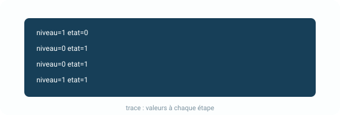
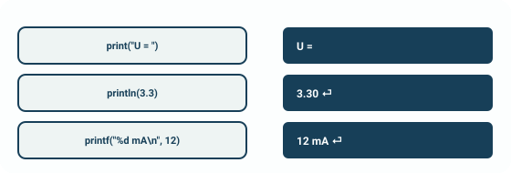

Un microcontrôleur n'a pas d'écran : quand un programme ne fait pas ce qu'on attend, le moniteur série devient l'instrument de diagnostic. On y affiche une **trace** : les valeurs importantes, à chaque étape.



Exemple : la bascule du module M3, avec une trace à chaque changement du bouton.

```cpp
#include <Arduino.h>

const uint8_t BUTTON_PIN = 4;
const uint8_t LED_PIN = 25;
// Mettre à false pour couper la trace sans toucher au reste
const bool TRACE = true;

int previousLevel = HIGH;
uint8_t ledState = 0;

void setup() {
  Serial.begin(115200);
  pinMode(BUTTON_PIN, INPUT_PULLUP);
  pinMode(LED_PIN, OUTPUT);
}

void loop() {
  int level = digitalRead(BUTTON_PIN);
  if (previousLevel == HIGH && level == LOW) {
    ledState ^= 1;
    delay(20);
  }
  if (TRACE && level != previousLevel) {
    Serial.printf("niveau=%d etat=%d t=%lu ms\n", level, ledState, (unsigned long)millis());
  }
  previousLevel = level;
  digitalWrite(LED_PIN, ledState);
}
```

## Lire une trace

Chaque ligne donne le niveau lu, l'état de la LED et l'instant. Un appui propre produit deux lignes : `niveau=0` à l'appui, `niveau=1` au relâchement. Si l'on voit plusieurs lignes en quelques millisecondes, ce sont des rebonds ; si `etat` ne change pas à l'appui, la détection de front est fautive.

## Les bonnes habitudes

- **Tracer les changements**, pas chaque tour de boucle : sinon le moniteur se noie et le programme ralentit (section 3).
- **Horodater** avec `millis()` : on voit l'ordre et la durée des événements.
- **Une constante** comme `TRACE` coupe toute la trace d'un coup, sans effacer les lignes.
- **Jamais de trace dans une routine d'interruption** (module M4) : on y note l'événement, `loop()` l'affiche.



## À retenir

- La trace série est le premier outil de diagnostic.
- Tracer les changements, avec l'instant.
- Une constante `TRACE` pour l'activer ou la couper.
