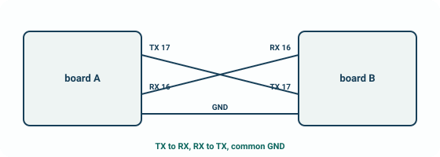
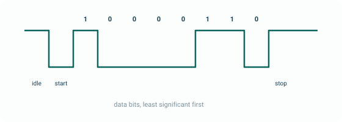

The ESP32 has **three UARTs**. UART 0 serves the monitor; **UART 2** (`Serial2`) is free to talk with another device: a second board, a GPS module, a serial display.



## Crossed wiring

- The **TX** of one goes to the **RX** of the other, and the other way round: what one transmits, the other receives.
- The **GNDs** are joined (rule 3 of module M1): without a common ground, the 0 and 3.3 V levels have no reference.
- Both devices must work at **3.3 V**. A module that transmits at 5 V goes through a voltage divider on its TX line (module M3).

## The program

This board acts as a relay: what you type in the monitor goes to the other board, and what the other board sends shows in the monitor.

```cpp
#include <Arduino.h>

// UART 2: RX on GPIO 16, TX on GPIO 17
const uint8_t RX2_PIN = 16;
const uint8_t TX2_PIN = 17;
const uint32_t LINK_BAUD = 9600;

void setup() {
  Serial.begin(115200);
  Serial2.begin(LINK_BAUD, SERIAL_8N1, RX2_PIN, TX2_PIN);
}

void loop() {
  // What is typed in the monitor goes to the other board
  while (Serial.available() > 0) {
    Serial2.write(Serial.read());
  }
  // What the other board sends shows in the monitor
  while (Serial2.available() > 0) {
    Serial.write(Serial2.read());
  }
}
```

`Serial2.begin(9600, SERIAL_8N1, 16, 17)` opens UART 2 at 9600 bit/s, in 8N1, with RX on GPIO 16 and TX on GPIO 17. The speed is free, as long as both boards choose the same; `write` sends a byte as it is, without turning it into text.



## Key points

- `Serial`: UART 0, the monitor. `Serial2`: UART 2, free.
- TX to RX, RX to TX, common GND, 3.3 V on both sides.
- `Serial2.begin(speed, SERIAL_8N1, RX, TX)`.
