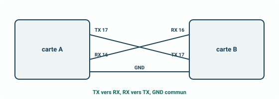
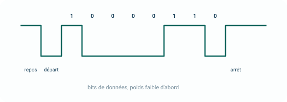

L'ESP32 possède **trois UART**. L'UART 0 sert au moniteur ; l'**UART 2** (`Serial2`) est libre pour dialoguer avec un autre appareil : une seconde carte, un module GPS, un afficheur série.



## Le câblage croisé

- Le **TX** de l'une va au **RX** de l'autre, et inversement : ce que l'une émet, l'autre le reçoit.
- Les **GND** sont reliés (règle 3 du module M1) : sans masse commune, les niveaux 0 et 3,3 V n'ont pas de référence.
- Les deux appareils doivent travailler en **3,3 V**. Un module qui émet en 5 V passe par un pont diviseur sur sa ligne TX (module M3).

## Le programme

Cette carte sert de relais : ce que vous tapez dans le moniteur part vers l'autre carte, et ce que l'autre carte envoie s'affiche dans le moniteur.

```cpp
#include <Arduino.h>

// UART 2 : RX sur GPIO 16, TX sur GPIO 17
const uint8_t RX2_PIN = 16;
const uint8_t TX2_PIN = 17;
const uint32_t LINK_BAUD = 9600;

void setup() {
  Serial.begin(115200);
  Serial2.begin(LINK_BAUD, SERIAL_8N1, RX2_PIN, TX2_PIN);
}

void loop() {
  // Ce qui est tapé dans le moniteur part vers l'autre carte
  while (Serial.available() > 0) {
    Serial2.write(Serial.read());
  }
  // Ce que l'autre carte envoie s'affiche dans le moniteur
  while (Serial2.available() > 0) {
    Serial.write(Serial2.read());
  }
}
```

`Serial2.begin(9600, SERIAL_8N1, 16, 17)` ouvre l'UART 2 à 9 600 bit/s, en 8N1, avec RX sur GPIO 16 et TX sur GPIO 17. La vitesse est libre, pourvu que les deux cartes choisissent la même ; `write` envoie un octet tel quel, sans le transformer en texte.



## À retenir

- `Serial` : UART 0, le moniteur. `Serial2` : UART 2, libre.
- TX vers RX, RX vers TX, GND commun, 3,3 V des deux côtés.
- `Serial2.begin(vitesse, SERIAL_8N1, RX, TX)`.
