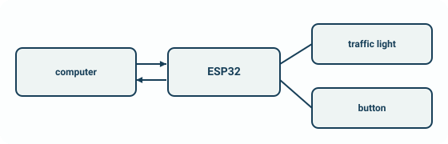

This mini-project turns the serial monitor into a **control desk**: you choose the colour of the traffic light and query the button by typing commands.

## Goal

Program a small command interpreter that acts on the outputs, reads an input and replies to each line received.

## Safety

- Circuit powered by the computer's USB; no circuit in the course goes above **12 V** DC.
- Never 5 V on a pin; the button is wired between GPIO 4 and GND, with the internal pull-up.
- Wire with the USB cable unplugged.



## Equipment

| Quantity | Item |
|---|---|
| 1 | ESP32 DevKit board, breadboard and wires |
| 3 | green, amber and red LEDs, with three 330 Ω resistors (GPIO 25, 26, 27) |
| 1 | push button between GPIO 4 and GND |
| 1 | multimeter |

## Program

```cpp
#include <Arduino.h>

const uint8_t BUTTON_PIN = 4;
const uint8_t GREEN_PIN = 25;
const uint8_t AMBER_PIN = 26;
const uint8_t RED_PIN = 27;

void showLight(uint8_t pin) {
  digitalWrite(GREEN_PIN, pin == GREEN_PIN ? HIGH : LOW);
  digitalWrite(AMBER_PIN, pin == AMBER_PIN ? HIGH : LOW);
  digitalWrite(RED_PIN, pin == RED_PIN ? HIGH : LOW);
}

void setup() {
  Serial.begin(115200);
  pinMode(BUTTON_PIN, INPUT_PULLUP);
  pinMode(GREEN_PIN, OUTPUT);
  pinMode(AMBER_PIN, OUTPUT);
  pinMode(RED_PIN, OUTPUT);
  showLight(RED_PIN);
  Serial.println("Commands: green, amber, red, button, help");
}

void loop() {
  if (Serial.available() == 0) {
    return;
  }
  String line = Serial.readStringUntil('\n');
  line.trim();
  line.toLowerCase();
  if (line == "green") {
    showLight(GREEN_PIN);
  } else if (line == "amber") {
    showLight(AMBER_PIN);
  } else if (line == "red") {
    showLight(RED_PIN);
  } else if (line == "button") {
    Serial.println(digitalRead(BUTTON_PIN) == LOW ? "pressed" : "released");
    return;
  } else if (line == "help") {
    Serial.println("green, amber, red: lights the colour; button: button state");
    return;
  } else {
    Serial.printf("Unknown command: %s\n", line.c_str());
    return;
  }
  Serial.printf("Light: %s\n", line.c_str());
}
```

`line.toLowerCase()` accepts `GREEN` as well as `green`. A state command (`button`) or the help command replies without changing the light.

## Full kit variant

1. Wire, upload, open the monitor: type `help`, then each command.
2. On the oscilloscope, channel 1 on GPIO 1 (the board's TX, available on the TX pin): send `green` and watch the reply; measure the duration of one bit (about 8.7 µs) and count the frames.

## Multimeter-only variant

1. Same circuit and same program.
2. For each colour command, measure the voltage of the three pins 25, 26 and 27.
3. Type `button` with the button released, then held.

| Measurement | Expected | Measured |
|---|---|---|
| after `green`: GPIO 25 / 26 / 27 | 3.3 V / 0 V / 0 V | |
| after `red`: GPIO 25 / 26 / 27 | 0 V / 0 V / 3.3 V | |
| `button`, button held | pressed | |
| `blue` | unknown command | |

## To conclude

Explain why the command `green` typed followed by a space still works.
