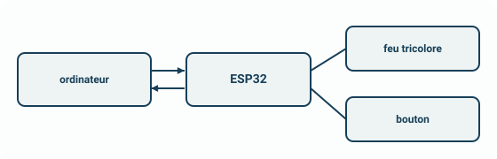

Ce mini-projet fait du moniteur série un **pupitre de commande** : on choisit la couleur du feu tricolore et on interroge le bouton en tapant des commandes.

## Objectif

Programmer un petit interpréteur de commandes qui agit sur les sorties, lit une entrée et répond à chaque ligne reçue.

## Sécurité

- Montage alimenté par l'USB de l'ordinateur ; aucun montage de la formation ne dépasse **12 V** en continu.
- Jamais 5 V sur une broche ; le bouton se branche entre GPIO 4 et GND, avec le tirage interne.
- Câblez câble USB débranché.



## Matériel

| Quantité | Élément |
|---|---|
| 1 | carte DevKit ESP32, plaque d'essai et fils |
| 3 | LED verte, orange et rouge, avec trois résistances de 330 Ω (GPIO 25, 26, 27) |
| 1 | bouton-poussoir entre GPIO 4 et GND |
| 1 | multimètre |

## Programme

```cpp
#include <Arduino.h>

const uint8_t BUTTON_PIN = 4;
const uint8_t GREEN_PIN = 25;
const uint8_t AMBER_PIN = 26;
const uint8_t RED_PIN = 27;

void showLight(uint8_t pin) {
  digitalWrite(GREEN_PIN, pin == GREEN_PIN ? HIGH : LOW);
  digitalWrite(AMBER_PIN, pin == AMBER_PIN ? HIGH : LOW);
  digitalWrite(RED_PIN, pin == RED_PIN ? HIGH : LOW);
}

void setup() {
  Serial.begin(115200);
  pinMode(BUTTON_PIN, INPUT_PULLUP);
  pinMode(GREEN_PIN, OUTPUT);
  pinMode(AMBER_PIN, OUTPUT);
  pinMode(RED_PIN, OUTPUT);
  showLight(RED_PIN);
  Serial.println("Commandes : vert, orange, rouge, bouton, aide");
}

void loop() {
  if (Serial.available() == 0) {
    return;
  }
  String line = Serial.readStringUntil('\n');
  line.trim();
  line.toLowerCase();
  if (line == "vert") {
    showLight(GREEN_PIN);
  } else if (line == "orange") {
    showLight(AMBER_PIN);
  } else if (line == "rouge") {
    showLight(RED_PIN);
  } else if (line == "bouton") {
    Serial.println(digitalRead(BUTTON_PIN) == LOW ? "appuyé" : "relâché");
    return;
  } else if (line == "aide") {
    Serial.println("vert, orange, rouge : allume la couleur ; bouton : état du bouton");
    return;
  } else {
    Serial.printf("Commande inconnue : %s\n", line.c_str());
    return;
  }
  Serial.printf("Feu : %s\n", line.c_str());
}
```

`line.toLowerCase()` accepte `VERT` comme `vert`. Une commande d'état (`bouton`) ou d'aide répond sans changer le feu.

## Variante kit complet

1. Câblez, téléversez, ouvrez le moniteur : tapez `aide`, puis chaque commande.
2. À l'oscilloscope, voie 1 sur GPIO 1 (TX de la carte, accessible sur la broche TX) : envoyez `vert` et observez la réponse ; mesurez la durée d'un bit (environ 8,7 µs) et comptez les trames.

## Variante multimètre seul

1. Même montage et même programme.
2. Pour chaque commande de couleur, mesurez la tension des trois broches 25, 26 et 27.
3. Tapez `bouton` bouton relâché, puis maintenu.

| Mesure | Attendue | Relevée |
|---|---|---|
| après `vert` : GPIO 25 / 26 / 27 | 3,3 V / 0 V / 0 V | |
| après `rouge` : GPIO 25 / 26 / 27 | 0 V / 0 V / 3,3 V | |
| `bouton`, bouton maintenu | appuyé | |
| `bleu` | commande inconnue | |

## Pour conclure

Expliquez pourquoi la commande `vert` tapée suivie d'un espace fonctionne quand même.
