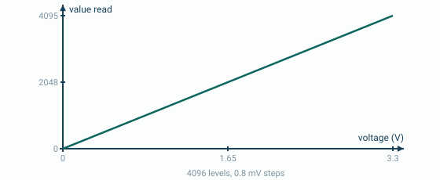
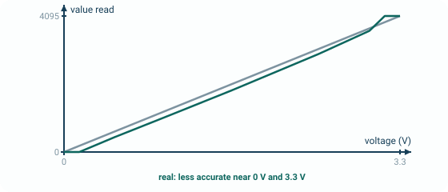

A digital input sees only 0 or 1. To measure a voltage, the ESP32 has a **12-bit analog-to-digital converter** (ADC): it turns a voltage into a whole number.



## 12 bits = 4096 levels

With 12 bits, the value goes from 0 to 2¹² − 1 = **4095**. In the ideal model used for the course calculations, 0 V gives 0 and 3.3 V gives 4095:

value = U / 3.3 V × 4095, and U = value × 3.3 V / 4095

One step is 3.3 V / 4095 ≈ 0.8 mV. Example: 1.65 V gives about 2048.

[[calc:adc]]

## The program

```cpp
#include <Arduino.h>

// Potentiometer wiper on GPIO 34 (ADC 1, input only)
const uint8_t POT_PIN = 34;

void setup() {
  Serial.begin(115200);
}

void loop() {
  uint16_t raw = analogRead(POT_PIN);              // 0 to 4095
  uint32_t millivolts = analogReadMilliVolts(POT_PIN);  // corrected voltage
  Serial.printf("raw=%u, %lu mV\n", raw, (unsigned long)millivolts);
  delay(500);
}
```

- `analogRead(pin)` returns the raw value, from 0 to 4095.
- `analogReadMilliVolts(pin)` directly returns the voltage in millivolts, applying the correction measured at the factory on the chip.

## The real measurement

The ESP32 ADC is not perfectly linear: it reads 0 below about 0.1 V and saturates a little before 3.3 V (around 3.1 V with the default setting).



For a precise measurement, stay in the middle of the range and prefer `analogReadMilliVolts`. For a potentiometer or a light threshold, `analogRead` is enough.

## Which pins?

The ESP32 has two converters: **ADC 1** (GPIO 32 to 39) and ADC 2 (GPIO 0, 2, 4, 12 to 15, 25 to 27). **ADC 2 is unavailable while Wi-Fi is running** (module M9). So get into the habit of using ADC 1, in particular GPIO 34 to 39, which are input-only pins (module M1).

## Key points

- 12-bit ADC: from 0 to 4095; ideal model: value = U / 3.3 × 4095.
- `analogReadMilliVolts` for a corrected voltage.
- Measurements on ADC 1 (GPIO 32 to 39): ADC 2 gives way to Wi-Fi.
