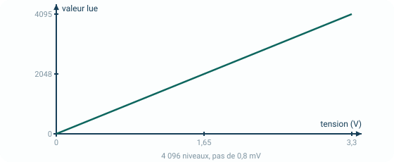
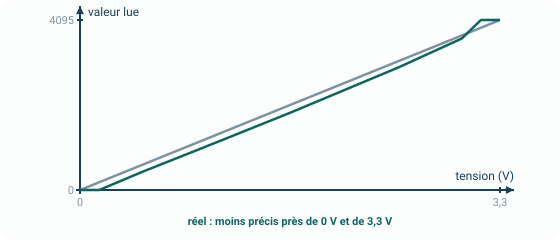

Une entrée numérique ne voit que 0 ou 1. Pour mesurer une tension, l'ESP32 dispose d'un **convertisseur analogique-numérique** (ADC) de **12 bits** : il traduit une tension en un nombre entier.



## 12 bits = 4 096 niveaux

Avec 12 bits, la valeur va de 0 à 2¹² − 1 = **4 095**. Dans le modèle idéal utilisé pour les calculs du cours, 0 V donne 0 et 3,3 V donne 4 095 :

valeur = U / 3,3 V × 4 095, et U = valeur × 3,3 V / 4 095

Un pas vaut 3,3 V / 4 095 ≈ 0,8 mV. Exemple : 1,65 V donne environ 2 048.

[[calc:adc]]

## Le programme

```cpp
#include <Arduino.h>

// Curseur du potentiomètre sur GPIO 34 (ADC 1, entrée seule)
const uint8_t POT_PIN = 34;

void setup() {
  Serial.begin(115200);
}

void loop() {
  uint16_t raw = analogRead(POT_PIN);              // 0 à 4095
  uint32_t millivolts = analogReadMilliVolts(POT_PIN);  // tension corrigée
  Serial.printf("brut=%u, %lu mV\n", raw, (unsigned long)millivolts);
  delay(500);
}
```

- `analogRead(broche)` rend la valeur brute, de 0 à 4 095.
- `analogReadMilliVolts(broche)` rend directement la tension en millivolts, en appliquant la correction mesurée en usine sur la puce.

## La mesure réelle

L'ADC de l'ESP32 n'est pas parfaitement linéaire : il lit 0 en dessous d'environ 0,1 V et sature un peu avant 3,3 V (vers 3,1 V avec le réglage par défaut).



Pour une mesure précise, on reste dans la plage du milieu et on préfère `analogReadMilliVolts`. Pour un potentiomètre ou un seuil de lumière, `analogRead` suffit.

## Quelles broches ?

L'ESP32 a deux convertisseurs : **ADC 1** (GPIO 32 à 39) et ADC 2 (GPIO 0, 2, 4, 12 à 15, 25 à 27). **ADC 2 est indisponible quand le Wi-Fi fonctionne** (module M9). On prend donc l'habitude d'utiliser ADC 1, en particulier GPIO 34 à 39, qui sont des entrées seules (module M1).

## À retenir

- ADC 12 bits : de 0 à 4 095 ; modèle idéal : valeur = U / 3,3 × 4 095.
- `analogReadMilliVolts` pour une tension corrigée.
- Mesures sur ADC 1 (GPIO 32 à 39) : ADC 2 cède la place au Wi-Fi.
