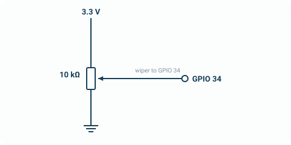
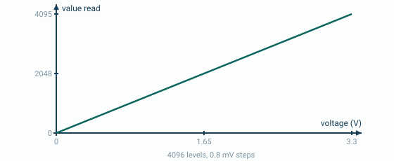

The simplest analog sensor is a **potentiometer**: a resistor with a wiper. Its ends go to 3.3 V and ground; the wiper takes a voltage in between.



It is a **voltage divider** whose ratio changes as the knob turns: wiper at the bottom, 0 V; in the middle, 1.65 V; at the top, 3.3 V.

## Supply at 3.3 V, never at 5 V

The potentiometer is supplied by the **3V3** pin of the board, never by the 5V pin: otherwise the wiper would rise up to 5 V, beyond what the input tolerates (rule 1 of module M1). A 10 kΩ value suits: 3.3 V / 10 kΩ = 0.33 mA in the track, very little.

## Read and show

The loop of the program in the previous section reads the wiper twice a second:

```cpp
void loop() {
  uint16_t raw = analogRead(POT_PIN);              // 0 to 4095
  uint32_t millivolts = analogReadMilliVolts(POT_PIN);  // corrected voltage
  Serial.printf("raw=%u, %lu mV\n", raw, (unsigned long)millivolts);
  delay(500);
}
```

Turning the knob, the raw value rises from 0 to 4095 and the corrected voltage from 0 to about 3300 mV.



## A sensor above 3.3 V

An analog sensor that outputs up to 5 V goes through a voltage divider, exactly as in module M3: with 10 kΩ and 20 kΩ, 5 V becomes 3.33 V. For an analog measurement, choose a ratio that brings the maximum down to about 3 V, in the range where the ADC is accurate.

[[calc:divider]]

## Key points

- A potentiometer is an adjustable voltage divider.
- Supplied at 3.3 V, it gives 0 to 3.3 V on the wiper.
- A 5 V sensor goes through a divider that brings its maximum down to about 3 V.
