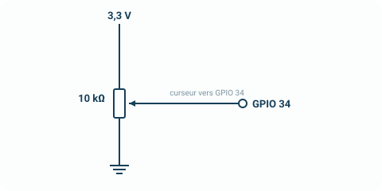
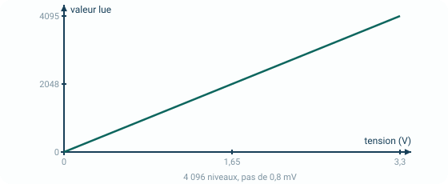

Le capteur analogique le plus simple est un **potentiomètre** : une résistance avec un curseur. Ses extrémités vont au 3,3 V et à la masse ; le curseur prend une tension entre les deux.



C'est un **pont diviseur** dont on fait varier le rapport en tournant le bouton : curseur en bas, 0 V ; au milieu, 1,65 V ; en haut, 3,3 V.

## Alimenter en 3,3 V, jamais en 5 V

Le potentiomètre est alimenté par la broche **3V3** de la carte, jamais par la broche 5V : sinon le curseur monterait jusqu'à 5 V, au-delà de ce que tolère l'entrée (règle 1 du module M1). Une valeur de 10 kΩ convient : 3,3 V / 10 kΩ = 0,33 mA dans la piste, très peu.

## Lire et afficher

La boucle du programme de la section précédente lit le curseur deux fois par seconde :

```cpp
void loop() {
  uint16_t raw = analogRead(POT_PIN);              // 0 à 4095
  uint32_t millivolts = analogReadMilliVolts(POT_PIN);  // tension corrigée
  Serial.printf("brut=%u, %lu mV\n", raw, (unsigned long)millivolts);
  delay(500);
}
```

En tournant le bouton, on voit la valeur brute monter de 0 à 4 095 et la tension corrigée de 0 à 3 300 mV environ.



## Un capteur au-delà de 3,3 V

Un capteur analogique qui sort jusqu'à 5 V passe par un pont diviseur, exactement comme au module M3 : avec 10 kΩ et 20 kΩ, 5 V deviennent 3,33 V. Pour une mesure analogique, on choisit un rapport qui ramène le maximum vers 3 V, dans la zone où l'ADC est précis.

[[calc:divider]]

## À retenir

- Un potentiomètre est un pont diviseur réglable.
- Alimenté en 3,3 V, il donne 0 à 3,3 V sur le curseur.
- Un capteur 5 V passe par un pont qui ramène son maximum vers 3 V.
