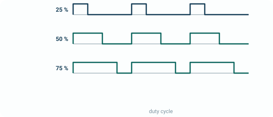
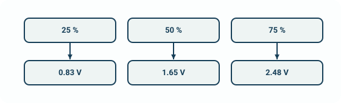

A digital output gives only 0 or 3.3 V. To set a brightness or a speed, it is made to **switch very fast** and the share of time spent high is varied: this is **pulse width modulation** (PWM).



## Duty cycle and average voltage

The **duty cycle** is the share of each period spent high. The **average** voltage is:

Uaverage = duty cycle × 3.3 V



At 5 kHz, the LED switches on and off 5000 times a second: the eye sees only the average, a more or less bright LED.

## The LEDC peripheral (3.x core)

The ESP32 produces PWM with a dedicated peripheral, **LEDC**, which works without the processor.

```cpp
#include <Arduino.h>

const uint8_t LED_PIN = 25;
const uint32_t PWM_FREQ_HZ = 5000;
const uint8_t PWM_BITS = 8;  // values from 0 to 255

void setup() {
  ledcAttach(LED_PIN, PWM_FREQ_HZ, PWM_BITS);
}

void loop() {
  // The brightness rises then falls
  for (int duty = 0; duty <= 255; duty++) {
    ledcWrite(LED_PIN, duty);
    delay(4);
  }
  for (int duty = 255; duty >= 0; duty--) {
    ledcWrite(LED_PIN, duty);
    delay(4);
  }
}
```

- `ledcAttach(pin, frequency, resolution)` prepares the pin: here 5 kHz and 8 bits.
- `ledcWrite(pin, value)` sets the duty cycle: with 8 bits, 0 = 0 %, 255 = 100 %, 128 ≈ 50 %.

Value = duty cycle × (2^bits − 1). The finer the resolution, the lower the maximum frequency: maximum frequency = 80 MHz / 2^bits, that is 312.5 kHz at 8 bits.

[[calc:pwm]]

> The `ledcSetup` and `ledcAttachPin` functions, found in many examples, belong to the 2.x core: they no longer build with the 3.x core.

## Key points

- PWM: fixed frequency, variable duty cycle; average = duty × 3.3 V.
- 3.x: `ledcAttach(pin, frequency, bits)`, then `ledcWrite(pin, value)`.
- At 8 bits: value from 0 to 255.
