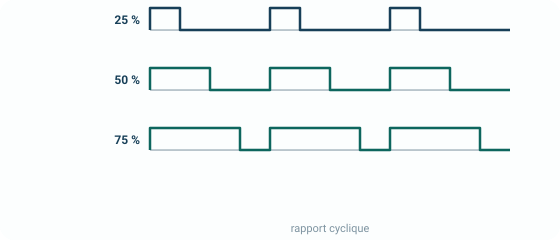
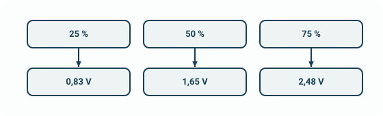

Une sortie numérique ne donne que 0 ou 3,3 V. Pour régler une luminosité ou une vitesse, on la fait **commuter très vite** et on joue sur la part du temps passée au niveau haut : c'est la **modulation de largeur d'impulsion** (MLI, en anglais PWM).



## Rapport cyclique et tension moyenne

Le **rapport cyclique** est la part de chaque période passée au niveau haut. La tension **moyenne** vaut :

Umoyenne = rapport cyclique × 3,3 V



À 5 kHz, la LED s'allume et s'éteint 5 000 fois par seconde : l'œil ne voit que la moyenne, une LED plus ou moins lumineuse.

## Le périphérique LEDC (cœur 3.x)

L'ESP32 produit la MLI avec un périphérique dédié, **LEDC**, qui travaille sans le processeur.

```cpp
#include <Arduino.h>

const uint8_t LED_PIN = 25;
const uint32_t PWM_FREQ_HZ = 5000;
const uint8_t PWM_BITS = 8;  // valeurs de 0 à 255

void setup() {
  ledcAttach(LED_PIN, PWM_FREQ_HZ, PWM_BITS);
}

void loop() {
  // La luminosité monte puis descend
  for (int duty = 0; duty <= 255; duty++) {
    ledcWrite(LED_PIN, duty);
    delay(4);
  }
  for (int duty = 255; duty >= 0; duty--) {
    ledcWrite(LED_PIN, duty);
    delay(4);
  }
}
```

- `ledcAttach(broche, fréquence, résolution)` prépare la broche : ici 5 kHz et 8 bits.
- `ledcWrite(broche, valeur)` règle le rapport cyclique : avec 8 bits, 0 = 0 %, 255 = 100 %, 128 ≈ 50 %.

Valeur = rapport cyclique × (2^bits − 1). Plus la résolution est fine, plus la fréquence maximale est basse : fréquence maximale = 80 MHz / 2^bits, soit 312,5 kHz en 8 bits.

[[calc:pwm]]

> Les fonctions `ledcSetup` et `ledcAttachPin`, que l'on trouve dans beaucoup d'exemples, appartiennent au cœur 2.x : elles ne compilent plus avec le cœur 3.x.

## À retenir

- MLI : fréquence fixe, rapport cyclique variable ; moyenne = rapport × 3,3 V.
- 3.x : `ledcAttach(broche, fréquence, bits)`, puis `ledcWrite(broche, valeur)`.
- En 8 bits : valeur de 0 à 255.
