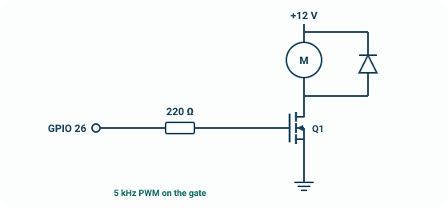
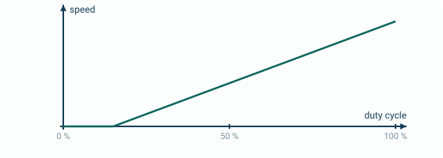

The MOSFET circuit of module M2 switched a 12 V motor on or off. By sending PWM to the gate instead of a fixed level, its **speed is set**.



## Why it works

The MOSFET switches the 12 V at the PWM rhythm. Because of its inertia and its coil, the motor does not follow each pulse: on average it receives duty cycle × 12 V. At 50 %, about 6 V on average.

The **freewheeling diode** becomes even more important: at each switch-off, thousands of times a second, the motor coil pushes its current on; the diode drains it.

## The program: the potentiometer sets the speed

```cpp
#include <Arduino.h>

const uint8_t POT_PIN = 34;
// MOSFET gate, through 220 ohms
const uint8_t MOTOR_PIN = 26;
const uint32_t PWM_FREQ_HZ = 5000;
const uint8_t PWM_BITS = 8;

void setup() {
  Serial.begin(115200);
  ledcAttach(MOTOR_PIN, PWM_FREQ_HZ, PWM_BITS);
}

void loop() {
  uint16_t raw = analogRead(POT_PIN);
  // 0 to 4095 brought down to 0 to 255
  uint32_t duty = map(raw, 0, 4095, 0, 255);
  ledcWrite(MOTOR_PIN, duty);
  Serial.printf("duty cycle: %lu %%\n", (unsigned long)(duty * 100 / 255));
  delay(200);
}
```

`map(raw, 0, 4095, 0, 255)` linearly converts the ADC value (0 to 4095) into an 8-bit duty cycle (0 to 255).

## The starting threshold



At low duty cycles, the average voltage is not enough to overcome friction: the motor hums without turning. Above the threshold, the speed roughly follows the duty cycle.

## Key points

- PWM on the MOSFET gate: average voltage = duty cycle × 12 V.
- Freewheeling diode essential.
- `map` converts 0 to 4095 into 0 to 255.
