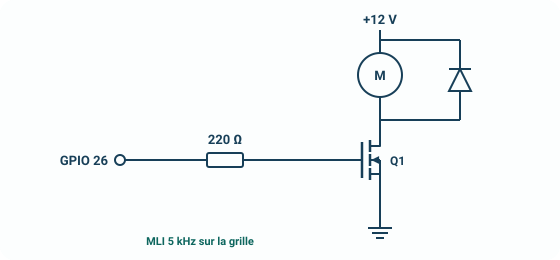
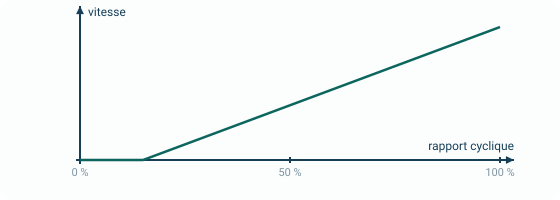

Le montage MOSFET du module M2 allumait ou arrêtait un moteur 12 V. En envoyant de la MLI sur la grille au lieu d'un niveau fixe, on **règle sa vitesse**.



## Pourquoi ça marche

Le MOSFET commute le 12 V au rythme de la MLI. Le moteur, à cause de son inertie et de sa bobine, ne suit pas chaque impulsion : il reçoit en moyenne rapport cyclique × 12 V. À 50 %, environ 6 V en moyenne.

La **diode de roue libre** devient encore plus importante : à chaque coupure, des milliers de fois par seconde, la bobine du moteur pousse son courant ; la diode l'écoule.

## Le programme : le potentiomètre règle la vitesse

```cpp
#include <Arduino.h>

const uint8_t POT_PIN = 34;
// Grille du MOSFET, à travers 220 ohms
const uint8_t MOTOR_PIN = 26;
const uint32_t PWM_FREQ_HZ = 5000;
const uint8_t PWM_BITS = 8;

void setup() {
  Serial.begin(115200);
  ledcAttach(MOTOR_PIN, PWM_FREQ_HZ, PWM_BITS);
}

void loop() {
  uint16_t raw = analogRead(POT_PIN);
  // 0 à 4095 ramené à 0 à 255
  uint32_t duty = map(raw, 0, 4095, 0, 255);
  ledcWrite(MOTOR_PIN, duty);
  Serial.printf("rapport cyclique : %lu %%\n", (unsigned long)(duty * 100 / 255));
  delay(200);
}
```

`map(raw, 0, 4095, 0, 255)` convertit linéairement la valeur de l'ADC (0 à 4 095) en rapport cyclique 8 bits (0 à 255).

## Le seuil de démarrage



Aux faibles rapports cycliques, la tension moyenne ne suffit pas à vaincre les frottements : le moteur ronronne sans tourner. Au-dessus du seuil, la vitesse suit à peu près le rapport cyclique.

## À retenir

- MLI sur la grille du MOSFET : tension moyenne = rapport cyclique × 12 V.
- Diode de roue libre indispensable.
- `map` convertit 0 à 4 095 en 0 à 255.
