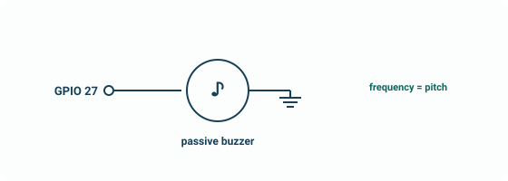
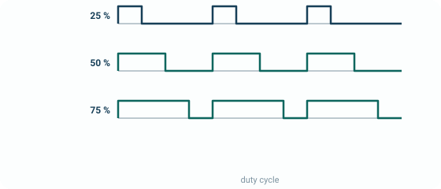

A **passive buzzer** is a small loudspeaker: it vibrates at the rhythm of the signal it receives. The **frequency** of the signal gives the **pitch** of the sound. An **active** buzzer contains its own oscillator and can make only one note: it is switched on like an LED.



## Playing a note

`ledcWriteTone(pin, frequency)` produces a square signal with a 50 % duty cycle at the requested frequency; `ledcWriteTone(pin, 0)` stops the sound. The pin must first be prepared with `ledcAttach`.

```cpp
#include <Arduino.h>

const uint8_t BUZZER_PIN = 27;
// C, E, G, high C, in hertz
const uint32_t NOTES_HZ[] = {262, 330, 392, 523};
const uint32_t NOTE_MS = 300;

void setup() {
  ledcAttach(BUZZER_PIN, 1000, 8);
}

void loop() {
  for (uint32_t note : NOTES_HZ) {
    ledcWriteTone(BUZZER_PIN, note);
    delay(NOTE_MS);
  }
  ledcWriteTone(BUZZER_PIN, 0);  // silence
  delay(1000);
}
```

| Note | Frequency |
|---|---|
| C | 262 Hz |
| E | 330 Hz |
| G | 392 Hz |
| A (tuning fork) | 440 Hz |
| high C | 523 Hz |

One octave up, the frequency doubles: high C (523 Hz) is twice C (262 Hz), give or take rounding.



## The buzzer current

A small piezoelectric buzzer draws a few milliamps: it connects directly to the pin. An 8 Ω magnetic loudspeaker would need much more: it would go through a transistor.

## Key points

- Passive buzzer: the frequency sets the pitch; active buzzer: a single note.
- `ledcWriteTone(pin, frequency)`, 0 for silence.
- One octave up = frequency doubled.
