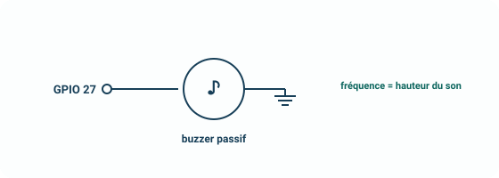
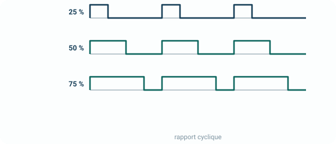

Un **buzzer passif** est un petit haut-parleur : il vibre au rythme du signal qu'on lui envoie. La **fréquence** du signal donne la **hauteur** du son. Un buzzer **actif**, lui, contient son propre oscillateur et ne sait faire qu'une seule note : il s'allume comme une LED.



## Jouer une note

`ledcWriteTone(broche, fréquence)` produit un signal carré de rapport cyclique 50 % à la fréquence demandée ; `ledcWriteTone(broche, 0)` coupe le son. La broche doit d'abord être préparée par `ledcAttach`.

```cpp
#include <Arduino.h>

const uint8_t BUZZER_PIN = 27;
// Do, mi, sol, do aigu, en hertz
const uint32_t NOTES_HZ[] = {262, 330, 392, 523};
const uint32_t NOTE_MS = 300;

void setup() {
  ledcAttach(BUZZER_PIN, 1000, 8);
}

void loop() {
  for (uint32_t note : NOTES_HZ) {
    ledcWriteTone(BUZZER_PIN, note);
    delay(NOTE_MS);
  }
  ledcWriteTone(BUZZER_PIN, 0);  // silence
  delay(1000);
}
```

| Note | Fréquence |
|---|---|
| do | 262 Hz |
| mi | 330 Hz |
| sol | 392 Hz |
| la (diapason) | 440 Hz |
| do aigu | 523 Hz |

Une octave plus haut, la fréquence double : le do aigu (523 Hz) vaut deux fois le do (262 Hz), à l'arrondi près.



## Le courant du buzzer

Un petit buzzer piézoélectrique consomme quelques milliampères : il se branche directement sur la broche. Un haut-parleur magnétique de 8 Ω, lui, demanderait bien plus : il passerait par un transistor.

## À retenir

- Buzzer passif : la fréquence fixe la hauteur ; buzzer actif : une seule note.
- `ledcWriteTone(broche, fréquence)`, 0 pour le silence.
- Une octave plus haut = fréquence doublée.
