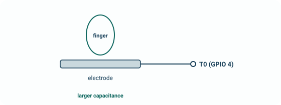
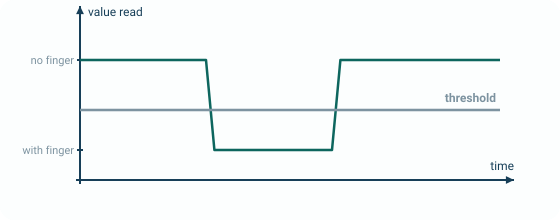

The ESP32 has **10 capacitive touch pins**, named T0 to T9. An electrode connected to one of them becomes a button with no moving part, even hidden under a sheet of plastic or glass.

## The principle

The electrode forms a **capacitor** with its surroundings. An approaching finger adds its own capacitance: the electrode charges more slowly. The chip measures this charging time and turns it into a number.



On the classic ESP32, the value read **drops** when touched.

| Touch pin | GPIO |
|---|---|
| T0 | 4 |
| T1, T2, T3 | 0, 2, 15 |
| T4, T5, T6 | 13, 12, 14 |
| T7, T8, T9 | 27, 33, 32 |

T1, T2, T3 and T5 are strapping pins (module M1): to start with, prefer T0 (GPIO 4), T4, T6, T7, T8 or T9.

## Detecting a touch with a threshold



```cpp
#include <Arduino.h>

// T0 is pin GPIO 4
const uint8_t TOUCH_PIN = T0;
const uint8_t LED_PIN = 25;
// Threshold chosen between the value without and with a finger
const uint32_t TOUCH_THRESHOLD = 30;

void setup() {
  Serial.begin(115200);
  pinMode(LED_PIN, OUTPUT);
}

void loop() {
  uint32_t value = touchRead(TOUCH_PIN);
  bool touched = (value < TOUCH_THRESHOLD);  // the value drops when touched
  digitalWrite(LED_PIN, touched ? HIGH : LOW);
  Serial.printf("touch=%lu %s\n", (unsigned long)value, touched ? "touched" : "");
  delay(100);
}
```

The threshold depends on the electrode, the wire and the humidity. Method: show the values without a finger (for example around 60) and with a finger (for example around 15), then place the threshold roughly in the middle.

## Key points

- 10 touch pins T0 to T9; T0 = GPIO 4.
- `touchRead(T0)`: the value drops on touch on the classic ESP32.
- Threshold chosen between the two measured values.
