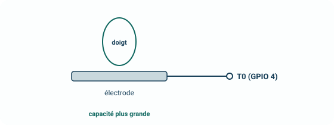
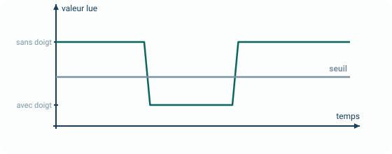

L'ESP32 possède **10 broches tactiles** capacitives, nommées T0 à T9. Une électrode reliée à l'une d'elles devient un bouton sans pièce mobile, même cachée sous une plaque de plastique ou de verre.

## Le principe

L'électrode forme un **condensateur** avec son environnement. Un doigt qui s'approche ajoute sa propre capacité : l'électrode se charge plus lentement. La puce mesure ce temps de charge et le traduit en nombre.



Sur l'ESP32 classique, la valeur lue **chute** quand on touche.

| Broche tactile | GPIO |
|---|---|
| T0 | 4 |
| T1, T2, T3 | 0, 2, 15 |
| T4, T5, T6 | 13, 12, 14 |
| T7, T8, T9 | 27, 33, 32 |

T1, T2, T3 et T5 sont des broches de strapping (module M1) : pour débuter, on préfère T0 (GPIO 4), T4, T6, T7, T8 ou T9.

## Détecter un contact par un seuil



```cpp
#include <Arduino.h>

// T0 est la broche GPIO 4
const uint8_t TOUCH_PIN = T0;
const uint8_t LED_PIN = 25;
// Seuil choisi entre la valeur sans doigt et la valeur avec doigt
const uint32_t TOUCH_THRESHOLD = 30;

void setup() {
  Serial.begin(115200);
  pinMode(LED_PIN, OUTPUT);
}

void loop() {
  uint32_t value = touchRead(TOUCH_PIN);
  bool touched = (value < TOUCH_THRESHOLD);  // la valeur chute quand on touche
  digitalWrite(LED_PIN, touched ? HIGH : LOW);
  Serial.printf("touch=%lu %s\n", (unsigned long)value, touched ? "touché" : "");
  delay(100);
}
```

Le seuil dépend de l'électrode, du fil et de l'humidité. Méthode : afficher les valeurs sans doigt (par exemple autour de 60) et avec doigt (par exemple autour de 15), puis placer le seuil à peu près au milieu.

## À retenir

- 10 broches tactiles T0 à T9 ; T0 = GPIO 4.
- `touchRead(T0)` : la valeur chute au contact sur l'ESP32 classique.
- Seuil choisi entre les deux valeurs mesurées.
