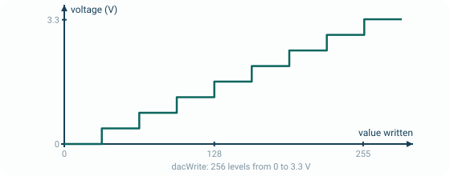
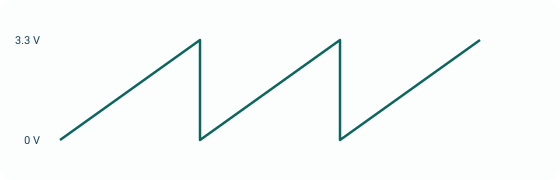

The reverse path of the ADC also exists: a **digital-to-analog converter** (DAC) turns a number into a voltage. The classic ESP32 has two of them, **8-bit**, on **GPIO 25** (DAC 1) and **GPIO 26** (DAC 2).



## 256 levels

`dacWrite(pin, value)` takes a value from 0 to 255. In the ideal model:

U = value × 3.3 V / 255

Example: 128 gives about 1.66 V. One step is 3.3 V / 255 ≈ 13 mV.

## PWM or DAC?

| | PWM | DAC |
|---|---|---|
| what the pin gives | 0 / 3.3 V pulses | a true DC voltage |
| pins | almost all | GPIO 25 and 26 only |
| use | LED, motor (the load does the averaging) | reference voltage, slow signal |

## A sawtooth ramp

```cpp
#include <Arduino.h>

// DAC 1 output: GPIO 25
const uint8_t DAC_PIN = 25;

void setup() {
}

void loop() {
  // Ramp from 0 to 3.3 V in 256 steps
  for (int value = 0; value <= 255; value++) {
    dacWrite(DAC_PIN, value);
    delay(10);
  }
}
```



The ramp takes 256 × 10 ms ≈ 2.6 s to rise. A slow multimeter follows it; an oscilloscope shows the steps.

The DAC supplies only a small current: it drives an input, not a load. The ESP32-S3 and ESP32-C3 have no DAC.

## Key points

- 8-bit DAC on GPIO 25 and 26: `dacWrite(pin, 0 to 255)`.
- U = value × 3.3 / 255.
- PWM for loads, DAC for a true DC voltage.
