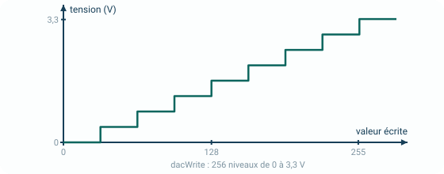
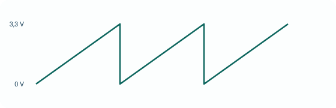

Le chemin inverse de l'ADC existe aussi : un **convertisseur numérique-analogique** (DAC) transforme un nombre en tension. L'ESP32 classique en a deux, de **8 bits**, sur **GPIO 25** (DAC 1) et **GPIO 26** (DAC 2).



## 256 niveaux

`dacWrite(broche, valeur)` reçoit une valeur de 0 à 255. Dans le modèle idéal :

U = valeur × 3,3 V / 255

Exemple : 128 donne environ 1,66 V. Un pas vaut 3,3 V / 255 ≈ 13 mV.

## MLI ou DAC ?

| | MLI | DAC |
|---|---|---|
| ce que donne la broche | des impulsions 0 / 3,3 V | une vraie tension continue |
| broches | presque toutes | GPIO 25 et 26 seulement |
| usage | LED, moteur (la charge fait la moyenne) | tension de référence, signal lent |

## Une rampe en dents de scie

```cpp
#include <Arduino.h>

// Sortie du DAC 1 : GPIO 25
const uint8_t DAC_PIN = 25;

void setup() {
}

void loop() {
  // Rampe de 0 à 3,3 V en 256 marches
  for (int value = 0; value <= 255; value++) {
    dacWrite(DAC_PIN, value);
    delay(10);
  }
}
```



La rampe met 256 × 10 ms ≈ 2,6 s à monter. Un multimètre lent la suit ; un oscilloscope montre les marches.

Le DAC ne fournit qu'un faible courant : il commande une entrée, pas une charge. Les ESP32-S3 et ESP32-C3 n'ont pas de DAC.

## À retenir

- DAC 8 bits sur GPIO 25 et 26 : `dacWrite(broche, 0 à 255)`.
- U = valeur × 3,3 / 255.
- MLI pour les charges, DAC pour une vraie tension continue.
