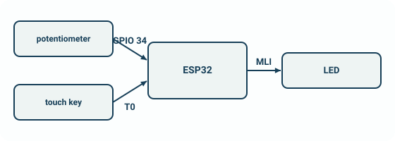

This mini-project brings the ADC, PWM and touch together: a **bedside lamp** whose brightness is set by a potentiometer and which a touch key switches on or off.

## Goal

Read a voltage, detect a touch with a threshold and drive a PWM output in the same loop, without blocking.

## Safety

- Circuit powered by the computer's USB; no circuit in the course goes above **12 V** DC.
- The potentiometer is supplied by the 3V3 pin, never by the 5V pin.
- Never 5 V on a pin. Wire with the USB cable unplugged.



## Equipment

| Quantity | Item |
|---|---|
| 1 | ESP32 DevKit board, breadboard and wires |
| 1 | 10 kΩ potentiometer, wiper on GPIO 34 |
| 1 | LED and 330 Ω resistor on GPIO 25 |
| 1 | electrode (stripped wire or a square of aluminium foil) on GPIO 4 (T0) |
| 1 | multimeter |

## Program

```cpp
#include <Arduino.h>

const uint8_t POT_PIN = 34;
const uint8_t TOUCH_PIN = T0;
const uint8_t LED_PIN = 25;
const uint32_t PWM_FREQ_HZ = 5000;
const uint8_t PWM_BITS = 8;
const uint32_t TOUCH_THRESHOLD = 30;

bool lampOn = false;
bool wasTouched = false;

void setup() {
  Serial.begin(115200);
  ledcAttach(LED_PIN, PWM_FREQ_HZ, PWM_BITS);
}

void loop() {
  // 1. Read the inputs
  bool touched = touchRead(TOUCH_PIN) < TOUCH_THRESHOLD;
  uint16_t raw = analogRead(POT_PIN);
  // 2. Compute: a new touch switches on or off
  if (touched && !wasTouched) {
    lampOn = !lampOn;
    Serial.println(lampOn ? "on" : "off");
  }
  wasTouched = touched;
  uint32_t duty = lampOn ? map(raw, 0, 4095, 0, 255) : 0;
  // 3. Write the output
  ledcWrite(LED_PIN, duty);
  delay(30);
}
```

The `TOUCH_THRESHOLD` threshold is 30; with your electrode, first measure the values (program of section 6) and adjust it.

## Full kit variant

1. Wire and upload; touch the electrode to switch on, turn the potentiometer.
2. On the oscilloscope on GPIO 25: measure the frequency (5 kHz) and the duty cycle for three knob positions.

## Multimeter-only variant

1. Same circuit and same program.
2. Measure the wiper voltage (GPIO 34) for three knob positions.
3. Measure the average voltage of GPIO 25 for the same positions, lamp on: the multimeter shows the PWM average.

| Measurement | Expected | Measured |
|---|---|---|
| wiper at the bottom end | 0 V | |
| wiper in the middle | 1.65 V | |
| GPIO 25, wiper in the middle, lamp on | about 1.65 V | |
| GPIO 25, lamp off | 0 V | |

## To conclude

Explain why a touch held for a long time on the electrode does not switch the lamp on and off over and over.
