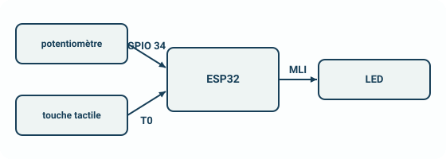

Ce mini-projet réunit l'ADC, la MLI et le tactile : une **lampe de chevet** dont un potentiomètre règle la luminosité et qu'une touche tactile allume ou éteint.

## Objectif

Lire une tension, détecter un contact par seuil et commander une sortie MLI dans la même boucle, sans blocage.

## Sécurité

- Montage alimenté par l'USB de l'ordinateur ; aucun montage de la formation ne dépasse **12 V** en continu.
- Le potentiomètre est alimenté par la broche 3V3, jamais par la broche 5V.
- Jamais 5 V sur une broche. Câblez câble USB débranché.



## Matériel

| Quantité | Élément |
|---|---|
| 1 | carte DevKit ESP32, plaque d'essai et fils |
| 1 | potentiomètre de 10 kΩ, curseur sur GPIO 34 |
| 1 | LED et résistance de 330 Ω sur GPIO 25 |
| 1 | électrode (fil dénudé ou carré de papier aluminium) sur GPIO 4 (T0) |
| 1 | multimètre |

## Programme

```cpp
#include <Arduino.h>

const uint8_t POT_PIN = 34;
const uint8_t TOUCH_PIN = T0;
const uint8_t LED_PIN = 25;
const uint32_t PWM_FREQ_HZ = 5000;
const uint8_t PWM_BITS = 8;
const uint32_t TOUCH_THRESHOLD = 30;

bool lampOn = false;
bool wasTouched = false;

void setup() {
  Serial.begin(115200);
  ledcAttach(LED_PIN, PWM_FREQ_HZ, PWM_BITS);
}

void loop() {
  // 1. Lire les entrées
  bool touched = touchRead(TOUCH_PIN) < TOUCH_THRESHOLD;
  uint16_t raw = analogRead(POT_PIN);
  // 2. Calculer : un nouveau contact allume ou éteint
  if (touched && !wasTouched) {
    lampOn = !lampOn;
    Serial.println(lampOn ? "allumée" : "éteinte");
  }
  wasTouched = touched;
  uint32_t duty = lampOn ? map(raw, 0, 4095, 0, 255) : 0;
  // 3. Écrire la sortie
  ledcWrite(LED_PIN, duty);
  delay(30);
}
```

Le seuil `TOUCH_THRESHOLD` vaut 30 ; avec votre électrode, mesurez d'abord les valeurs (programme de la section 6) et ajustez-le.

## Variante kit complet

1. Câblez et téléversez ; touchez l'électrode pour allumer, tournez le potentiomètre.
2. À l'oscilloscope sur GPIO 25 : mesurez la fréquence (5 kHz) et le rapport cyclique pour trois positions du bouton.

## Variante multimètre seul

1. Même montage et même programme.
2. Mesurez la tension du curseur (GPIO 34) pour trois positions du bouton.
3. Mesurez la tension moyenne de GPIO 25 pour les mêmes positions, lampe allumée : le multimètre affiche la moyenne de la MLI.

| Mesure | Attendue | Relevée |
|---|---|---|
| curseur en butée basse | 0 V | |
| curseur au milieu | 1,65 V | |
| GPIO 25, curseur au milieu, lampe allumée | environ 1,65 V | |
| GPIO 25, lampe éteinte | 0 V | |

## Pour conclure

Expliquez pourquoi un contact maintenu longtemps sur l'électrode n'allume et n'éteint pas la lampe en boucle.
