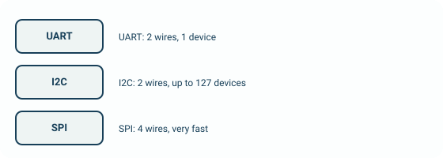
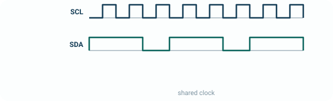

To talk with a display, a sensor or a memory card, the ESP32 has three serial links. The UART of module M5 connects two devices; **I2C** and **SPI** connect several on the same wires.

## Asynchronous or synchronous

The UART is **asynchronous**: both sides agreed on the speed in advance. I2C and SPI are **synchronous**: a **clock** wire, driven by the ESP32, tells the receiver when to read each bit.

The ESP32 is the **controller** (master): it supplies the clock and chooses which device it talks to. The sensors and the display are **targets** (slaves): they reply when queried.

## Choosing a bus

| | I2C | SPI |
|---|---|---|
| wires | 2: SDA (data), SCL (clock) | 4: MOSI, MISO, SCK, plus one CS per device |
| choosing the device | an **address** in the message | one **CS** line per device |
| usual speed | 100 or 400 kbit/s | several Mbit/s |
| examples | OLED display, BME280 sensor | microSD card, fast display |

Rule of thumb: I2C for small sensors and small displays, which need little; SPI when a lot of throughput is needed, such as a memory card.

## Key points

- I2C and SPI are synchronous: the ESP32, as controller, supplies the clock.
- I2C: 2 wires, devices chosen by address. SPI: 4 wires, one CS per device, faster.
